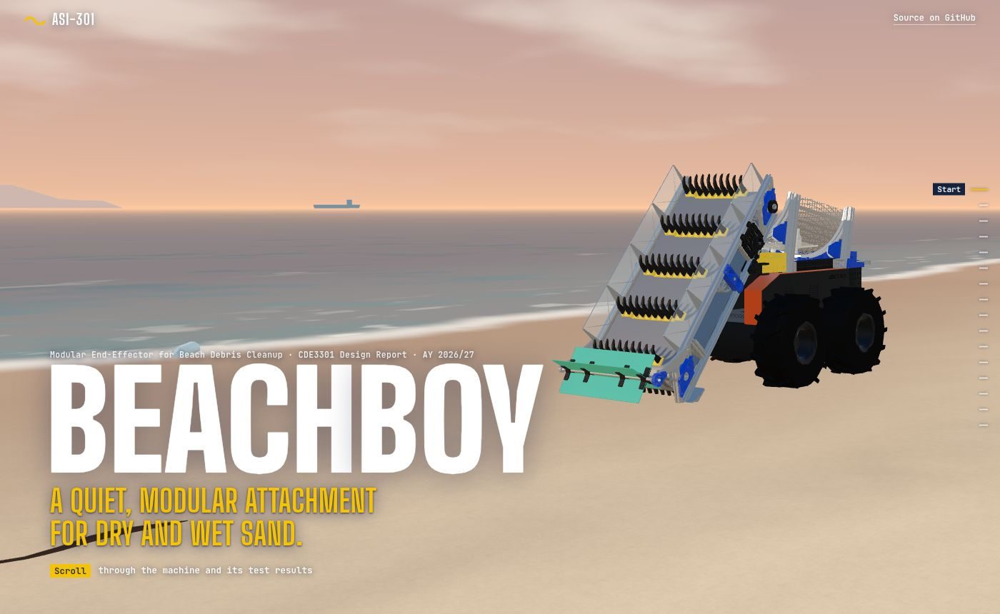

# BeachBoy

ASI-301: a modular end-effector for beach debris cleanup. CDE3301 Design Report, AY 2026/27.

**[Scroll through the machine in 3D](https://jeonwonje.com/beachboys/)**



## What it is

A payload on a Botsync Copernicus electric base, built to collect debris from dry and wet sand.

1. **Collect.** A meshed conveyor with hooked spokes lifts debris and sheds loose sand as it climbs. A ratcheting front paddle stops larger items from being pushed away.
2. **Separate.** A U-shaped trommel half-drum rocks the load against its mesh to shake off wet sand.
3. **Store.** Sand falls onto a collection tray and debris carries on into the bin. Every subsystem comes off with quick-release pins.

## Results

In sandpit bench tests, it ran below the noise threshold and stopped all motion on emergency stop. On Palawan Beach, collection fell well short of the 0.80 target: 37.5% at best on dry sand and 6.3% at best on wet sand. The wet band's cross-slope tipped debris off the conveyor before it reached the drum, and soft sand let the skid sink, which jammed the conveyor and stalled the robot.

Workers ran the machine with little help. Both operators and the site manager said it would save them from bending to re-collect debris dropped by the bobcat.

Everything on the site comes from the design report.

## The site

The site is in [`web/`](web/): Vite and three.js, with no framework. Pushing to `main` deploys it to GitHub Pages.

```bash
cd web
npm install
npm run dev
```

## Team

Chen Zhi Yi Gary, Jeon Wonje, Kow Ming Yuan, Ng Jing Jie Russell and Wang Yizhang. Supervised by Mr. Nicholas Chew and Mr. Royston Shieh.

## Credits

The Copernicus carrier geometry comes from [botsync/copernicus](https://github.com/botsync/copernicus) (BSD-3-Clause).
