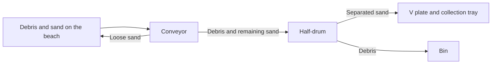
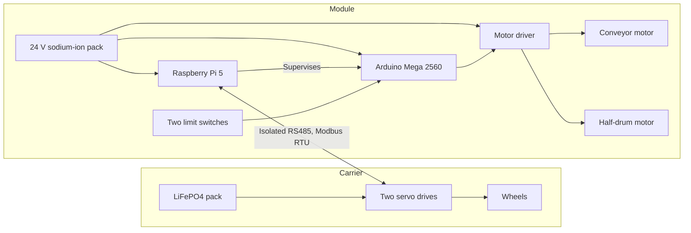

# ASI-301: Modular End-Effector for Beach Debris Cleanup

**BeachBoy Engineering Report**

| | |
|---|---|
| **Course** | CDE3301, AY 2026/27 |
| **Machine** | BeachBoy, on a Botsync Copernicus carrier |
| **Status** | Proof of concept. Field collection rate is below the requirement. |
| **Authors** | Chen Zhi Yi Gary, Jeon Wonje, Kow Ming Yuan, Ng Jing Jie Russell, Wang Yizhang |
| **Supervisors** | Mr. Nicholas Chew, Mr. Royston Shieh |
| **Interactive 3D** | [jeonwonje.com/beachboys](https://jeonwonje.com/beachboys/) |


*Figure 3: Final design of BeachBoy.*

## Abstract

Tractor-towed sieves clear dry beach sand, but sieves blind on wet sand. Workers still clear the wet intertidal band by hand. They sweep debris into piles and lift each pile into a tractor bucket, often in the heat.

ASI-301 set out to build a quiet, modular attachment that collects debris from dry and wet sand. The BeachBoy mounts on a Botsync Copernicus electric base. A conveyor lifts the debris, and a half-drum rocks the load against its mesh to shake off wet sand.

In sandpit tests, the machine ran below the noise threshold and stopped all motion on emergency stop. On Palawan Beach, collection fell well short of the target, especially on the wet band. The wet band's cross-slope was steeper than anticipated, and it tipped debris off the conveyor before the debris reached the half-drum.

Contractor workers ran the machine with little help. The BeachBoy answers the workflow problem, but it does not yet collect enough debris to replace hand clearing of the wet band.

## Contents

| Section | Title | Content |
|---|---|---|
| [1](docs/01-introduction.md) | Introduction | Problem, existing machines, gaps, debris classes |
| [2](docs/02-requirements.md) | Requirements | D1 to D10, compliance matrix, progression gates |
| [3](docs/03-system-design.md) | System Design | Concept, subsystems, workflow |
| [4](docs/04-electrical.md) | Electrical and Firmware | Power domains, wiring, control, firmware |
| [5](docs/05-development.md) | Development | Build iterations, problem codes |
| [6](docs/06-test-and-evaluation.md) | Test and Evaluation | Bench, field and user test results |
| [7](docs/07-calculations.md) | Calculations | Half-drum, collection unit and conveyor checks |
| [8](docs/08-carrier-repair.md) | Carrier Repair | Copernicus repair, control interface |
| [9](docs/09-conclusions.md) | Conclusions | Conclusions, future work, open items |
| [10](docs/10-references.md) | References | Cited sources |
| [Files](hardware/README.md) | Engineering Files | Wiring diagrams, firmware, case drawings, CAD |

## System overview

The module works in two stages. The conveyor lifts debris and sheds loose sand through its belt. The half-drum then removes the remaining wet sand.



The machine has two isolated power domains. They connect only through an isolated RS485 link.



The [wiring diagram](hardware/electrical/ASI-301_Wiring_v2.png) (Figure 15) gives the full connections. [Section 3](docs/03-system-design.md) and [Section 4](docs/04-electrical.md) give the details.

Source: Report Sections 2.1 and 3.2, Figure 15.

## Requirement compliance

| ID | Requirement | Threshold | Result |
|---|---|---|---|
| D1 | Collect debris in the wet band | Collection rate 0.80 or better per class | **Fail** on field: 37.5% at best on dry sand, 6.3% at best on wet sand |
| D2 | Separate wet sand from debris | Majority of sand settles on the tray, debris loss 0.05 or less | **Fail** on settling. Debris loss passes at 0% (Table 12) |
| D3 | Operate below noise threshold | Under 60 dB(A) at 1 m | Pass |
| D4 | Mass within carrier capacity | Moves with the bin at a 10 kg payload | Pass |
| D5 | Resist salt and wet sand | No corrosion initiation or binding | **Not tested** |
| D6 | Traverse the wet band | Observed to traverse in both sand conditions | Pass, with limits. Jams impede motion, and wheels slip in wet sand |
| D7 | Shift-end clearing, hand tools only | Two people, hand tools only | Pass. Field clear-out took 5.23 minutes |
| D8 | Reduce strain of clearing | Physical demand below the current manual workflow | Pass, qualitative |
| D9 | Operable by a worker unaided | 5 of 6 tasks unaided | Pass |
| D10 | Operate safely near the public | All motion ceases upon emergency stop | Pass |

[Section 2](docs/02-requirements.md) links each result to its test evidence.

Source: Report Tables 2 and 12, Figures 17 and 18.

## Field results


*Figure 18: Overall collection rate (M7) by condition.*

Intake was below the 80% threshold in all four conditions. Moisture made its difference at transfer. Dry transfer held at 100%, and wet transfer reached at most 16.7% overall. [Section 6](docs/06-test-and-evaluation.md) gives the per-class data.

Source: Report Section 4.2, Figures 18 and 19.

## Repository structure

```text
docs/                 Engineering report, sections 1 to 10
docs/figures/         Figures from the design report
hardware/electrical/  Wiring diagrams, bill of materials, driver guide
hardware/firmware/    Arduino Mega firmware
hardware/electronics-case/  Laser-cut case: DXF, drawing, STEP, SolidWorks, generator
hardware/module/      3D model of the machine
hardware/carrier/     Copernicus CAD, with its BSD-3-Clause licence
web/                  Source of the interactive 3D site
```

## Site development

Pushes to `main` that change `web/` deploy the site to GitHub Pages. To run the site locally, do these steps:

```bash
cd web
npm install
npm run dev
```

## Document conventions

- **Source.** The facts in these documents come from the ASI-301 design report. Files in `hardware/` also describe their own contents. Each subsection states its source.
- **Numbering.** Figures and tables keep their numbers from the design report.
- **Language.** The text follows the structural rules of ASD-STE100 Simplified Technical English, as applied by the [asd-ste100 skill](https://github.com/danyuchn/asd-ste100-skill). The text was not checked against the ASD dictionary, and it is not certified STE.
- **Exclusions.** These public documents do not name the beach cleaning contractor or its staff.
- **Open items.** [Section 9.3](docs/09-conclusions.md#93-open-items) lists points where the source documents disagree.

## Licence

This repository does not have a licence yet. The Copernicus files have their own [licence](hardware/carrier/LICENSE-botsync-copernicus.txt).
