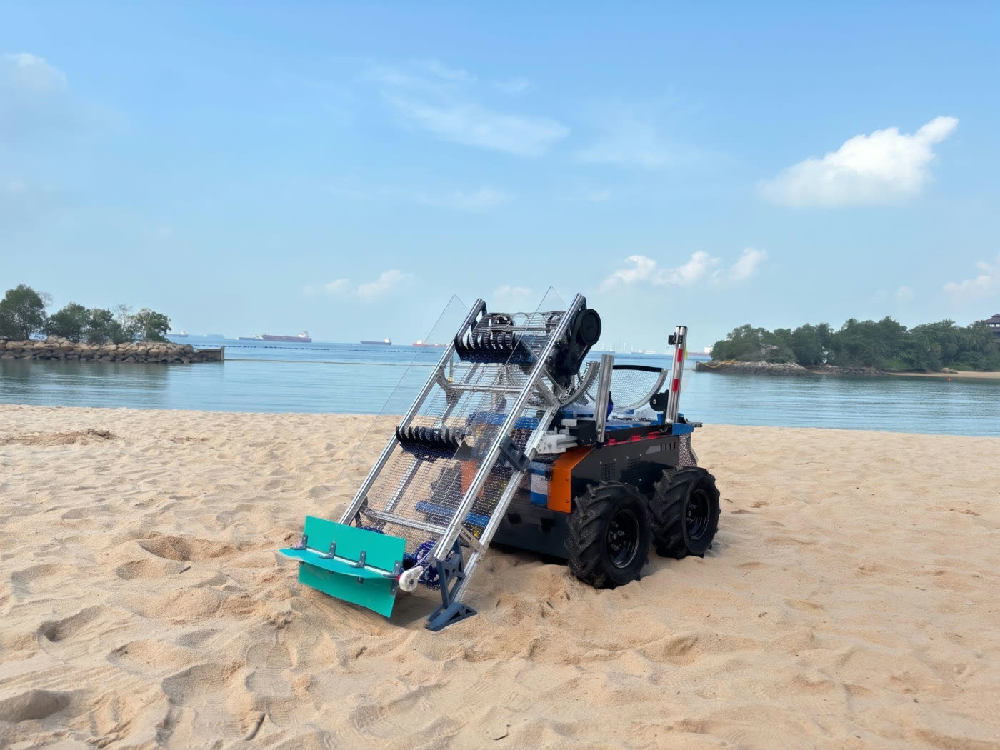

# ASI-301: Modular End-Effector for Beach Debris Cleanup

**BeachBoy engineering report.** CDE3301, AY 2026/27. [Interactive 3D model](https://jeonwonje.com/beachboys/)

**Authors:** Chen Zhi Yi Gary, Jeon Wonje, Kow Ming Yuan, Ng Jing Jie Russell, Wang Yizhang. **Supervisors:** Mr. Nicholas Chew, Mr. Royston Shieh.

## Summary

Tractor-towed sieves blind on wet sand, so workers clear the wet intertidal band by hand. The BeachBoy is a module on a Botsync Copernicus base, built to collect debris from dry and wet sand. A conveyor lifts the debris, and a half-drum rocks the load against its mesh to shake off wet sand.

**Status: proof of concept.** It answers the workflow problem, but it does not yet collect enough debris to replace hand clearing of the wet band.

| Result | Value | Target |
|---|---|---|
| Field collection rate, dry sand, best | 37.5% | 80% per class |
| Field collection rate, wet sand, best | 6.3% | 80% per class |
| Noise at 1 m, on the bench | Below 60 dB(A) | Under 60 dB(A) |
| Emergency stop | All motion stopped immediately | All motion ceases |
| Clear-out, two people with hand tools | 5.23 minutes | Hand tools only |
| Operating tasks completed unaided | 5 of 6 | 5 of 6 |

On Palawan Beach, the wet band's cross-slope tipped debris off the conveyor before the debris reached the half-drum.

## Contents

1. [Problem and requirements](docs/01-problem-and-requirements.md): D1 to D10 and their results
2. [Design](docs/02-design.md): subsystems and workflow
3. [Electrical, firmware and carrier](docs/03-electrical.md)
4. [Development and tests](docs/04-development-and-tests.md): build iterations, bench, field and user results
5. [Calculations](docs/05-calculations.md)
6. [Conclusions](docs/06-conclusions.md): future work, open items and references

[Engineering files](hardware/README.md): full CAD assembly, wiring diagrams, firmware and laser-cut case.
