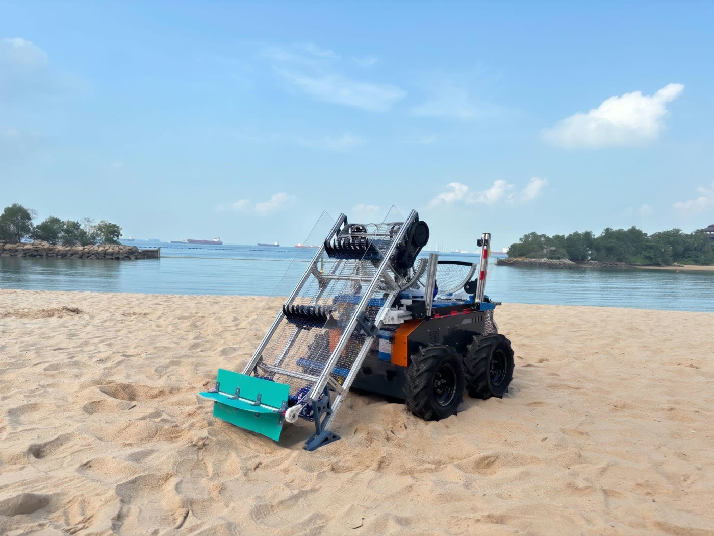
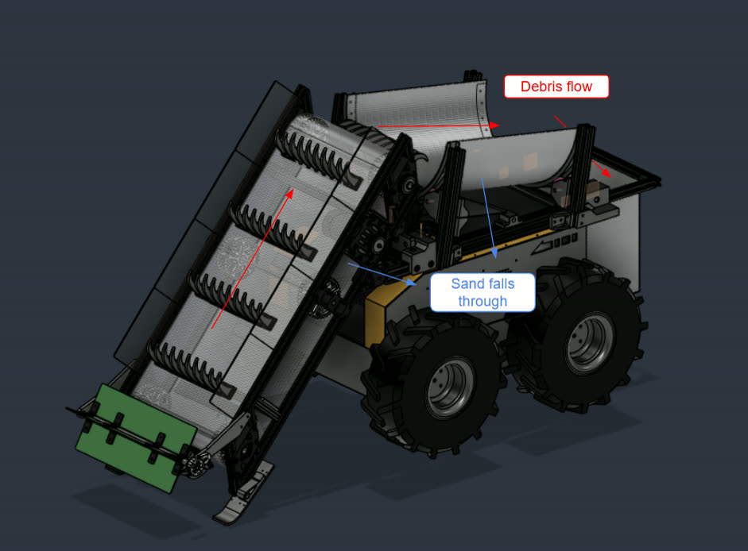
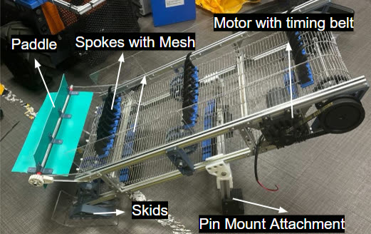
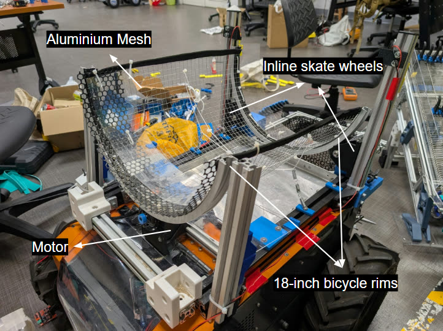
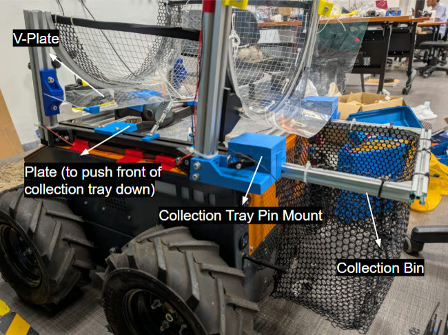

# 2. Design
[Contents](../README.md) · [Previous](01-problem-and-requirements.md) · [Next](03-electrical.md)

## 2.1 Concept

*Figure 3: Final design of BeachBoy.*

The module works in two stages:

1. **Lift.** The conveyor lifts debris. Loose sand falls through its meshed belt.
2. **Separate.** The trommel half-drum rocks the load against its 5 mm mesh. The purpose is to remove remaining wet sand through impact and agitation.

Sand falls onto the collection tray. Debris continues into the bin.

*Figure 4: Initial CAD, with the debris and sand paths.*

Source: Report 2.1, Fig. 3, 4.

## 2.2 Carrier

| Item | Value |
|---|---|
| Base | Botsync Copernicus, differential drive, 2 top-mounted 4040 aluminium rails |
| Batteries | Carrier: LiFePO4 pack, for the wheel drives. Module: 24 V sodium-ion pack, for everything else |
| Drives, control | 2 Trumman EV servo drives. Wireless controller |
| Mobility | At B3.0b, moves with a 10 kg payload, with some impeding of motion when turning in the sandpit. Not tested with a full bin |
| Noise | At B5.0, below 60 dB(A) at 1 m while traversing, with the conveyor and half-drum running |

Source: Report 2.2.1, 3.2, Tables 7, 10, App. F.

## 2.3 Conveyor

*Figure 5: Conveyor.*

Hooked spokes on a mesh belt lift debris and the sand around it to the half-drum. The spokes tend to push larger items forward. The front paddle lets debris in and blocks the items from moving back out.

| Item | Value |
|---|---|
| Frame | 1020 mm long, B3.0 onward. 40° incline, measured on the assembly |
| Skid | 50 mm high, B3.0 onward. Nominal digging depth 10 mm |
| Spokes | 30 mm pitch, 8 mm thick, 22 mm clear gap, 60 mm tip reach below skid datum. Mesh strip across the row, 10 mm aperture |
| Belt | 350 mm wide, 10 mm mesh aperture |
| Motor | 24 V, 40 W, geared, 120 rpm, 3.236 N·m continuous |
| Drive | S5M timing belt, 3:1. Lower bounds: 2.93 torque, 2.92 release. Speed check: open item |
| Mount | 2 quick-release pins, 10 mm |
| Front paddle | Rotates passively, counter-clockwise only, by ratchet. |

Report H.7 states that the tip reach and the incline should be checked from CAD.

Source: Report 2.2.2, Fig. 5, Table H.1, App. H.

## 2.4 Half-drum

*Figure 12: Trommel half-drum subsystem.*

| Item | Value |
|---|---|
| Form | U-shaped rocking half-drum. Bicycle rim, inline skate wheels. Aluminium mesh, 5 mm |
| Drive | Friction drive, 64 mm wheel. 2 springs at the midpoint give additional downforce. Motor: 100 rpm, 40 W, 24 V |
| Rocking | 2 normally closed limit switches, 150 ms coast at each end. 0.24 of critical speed |
| Torque margin | 1.8 worst case at an assumed 50% efficiency. Grip at the contact, spring force and friction coefficient not measured |
| Motor shield | Polycarbonate sheet over the front face, reduced at B5.0 |

Source: Report 2.1, 2.2.3, 3.2, Fig. 12, Tables 4, 6, 9, App. D.

## 2.5 Tray and bin

*Figure 13: Collection tray & bin.*

The tray and the bin are a connected unit that slides out through the back.

| Item | Value |
|---|---|
| Tray | 335 × 338 × 25.4 mm, measured. 1 mm aluminium. About 2.9 L at the brim |
| Bin | Meshed, 10 kg design payload. Not tested with a full bin |
| V plate | 2 mm acrylic, about 10°, keeps sand off the motor. Reduced at B5.0 |
| Mount | Rear: 2 × 10 mm stainless steel quick-release pins. Front: flat PETG pushers |

Source: Report 2.2.4, Fig. 13, Table 9, App. E.

## 2.6 Workflow

The system is meant to work alongside the contractor's tractors, not replace them. The BeachBoy takes over the wet band, which workers now clear by hand.

Two workers do this procedure. Do steps 1 and 2 at the same time.

1. Worker 1: Drive the BeachBoy along the wet band by remote control.
2. Worker 2: Walk alongside the BeachBoy. Clear the jams.
3. Check the bin. If the bin is not full, go to step 7.
4. Slide the collection tray out of the BeachBoy.
5. Empty the bin into the utility vehicle.
6. Tip the sand back onto the beach. Go to step 1.
7. Check the time. If the shift is not at its end, go to step 1.
8. Pull the quick-release pins on the conveyor, the half-drum and the collection tray.
9. Clean each subsystem.
10. Do the maintenance on each subsystem.

Source: Report 1.1, 2.3, Fig. 14.
