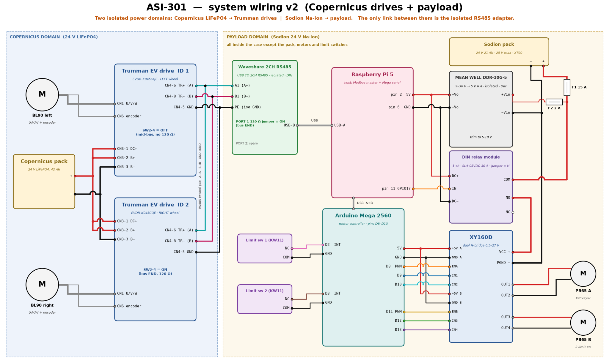

# 3. Electrical, Firmware and Carrier
[Contents](../README.md) · [Previous](02-design.md) · [Next](04-development-and-tests.md)

## 3.1 Power and control

The carrier domain uses a LiFePO4 pack for the wheel drives. The module domain uses a 24 V sodium-ion pack for everything else. The domains connect only through an isolated RS485 link, so a payload fault cannot reach the drives.

*Figure 15: System wiring.*

The Raspberry Pi 5 talks to the servo drives over Modbus RTU. It switches the payload relay and supervises the Arduino Mega 2560, which drives the motors. The electronics case is not sealed, and D5 has the status "Not tested".

Source: Report 3.2, Table 12, Fig. 15.

## 3.2 Components

| Component | Data in Figure 15 |
|---|---|
| Carrier pack | 24 V LiFePO4, 42 Ah |
| Trumman EV drives | EVDR-K045CQE. ID 1: left, SW2-4 OFF, no 120 Ω. ID 2: right, SW2-4 ON, 120 Ω |
| Module pack | 24 V sodium-ion, 25 V maximum, XT90 |
| Fuses | F1 15 A, F2 2 A |
| DDR-30G-5 | 9–36 V to 5 V, 6 A, isolated. Trim to 5.10 V |
| DIN relay | SLA-05VDC, 30 A, jumper at H |
| Waveshare 2CH RS485 | Isolated. Port 1: 120 Ω jumper ON |
| XY160D | Dual H-bridge, 6.5–27 V |

## 3.3 Firmware

Source file: [XY160D_LimitSwitch_Mega.ino](../hardware/firmware/XY160D_LimitSwitch_Mega/XY160D_LimitSwitch_Mega.ino). Motor A (PB65 A) is the conveyor motor. Motor B (PB65 B) drives the half-drum.

| Mega pin | Connects to |
|---|---|
| D8, D9, D10 | XY160D ENA, IN1, IN2 (motor A) |
| D11, D12, D13 | XY160D ENB, IN3, IN4 (motor B) |
| D2, D7 | KW11 limit switches 1, 2, NC |

- **Start:** Both motors start with no command at 230 of 255. The file calls this value 90%.
- **Switch input:** The pin reads LOW in normal operation, and HIGH on a hit or a broken wire.
- **Shuttle:** Motor B hits a switch, coasts for 150 ms, then reverses. The firmware ignores that switch until motor B reaches the other switch.
- **Faults:** Motor B stops if both inputs are active, or if a switch stays active more than 1500 ms after the reverse. It stays off until the next `b` command or reset.
- **Motor A:** Only an `a` command with speed 0, the `s` command or a power loss stops motor A.

Serial commands (9600 baud, line ending "Newline", speed −255 to 255):

- `a<speed>`: sets motor A speed.
- `b<speed>`: sets motor B speed and starts the shuttle.
- `s`: stops both motors.
- `?`: prints speeds and switch states.

WARNING: DO NOT CONNECT THE MOTOR SUPPLY TO THE MEGA. CONNECT XY160D VCC AND PGND TO THE MOTOR SUPPLY THROUGH A 10–15 A FUSE.

Do the logic supply check in the firmware file header before you connect XY160D +5V to the Mega.

## 3.4 Open items

| Item | Conflict |
|---|---|
| Limit switch 2 | Firmware uses D7, the reference. Figure 15 shows D3 |
| Module pack capacity | Report 3.2 and Figure 15 do not agree. No capacity or runtime given |
| Emergency stop | Table 10 records the result. Figure 15 does not show the circuit |
| Broken wire | Report 3.2: the Mega stops the half-drum. The firmware sequence differs |

## 3.5 Carrier repair

- **Fault:** The onboard computer would not power up. The STM32 did not respond to serial requests.
- **Board:** The team bypassed the STM32 control functions. The board kept only inrush current limiting and the E-stop.
- **Host:** A Raspberry Pi commands both drives directly at 115200 baud.
- **Drive mode:** In speed mode, the host writes a speed setpoint register and toggles a remote run/direction register.
- **Bus:** The first drive had its termination resistor enabled, although it was not at the bus end. The team set the DIP switches correctly.
- **Manual control:** A Python script maps wireless controller inputs to drive commands and stops both motors on any fault. The ROS integration was lost.
- **Proof test:** At West Coast Park, on dry and wet sand, the carrier ran 30 minutes continuously with no faults.

Source: Report Appendix F.

## 3.6 Control interface notes

- **Path:** Host, USB-RS485 adapter, one Modbus RTU bus, two drives. The Botsync board and STM32 are not in the path.
- **Timing:** One Modbus transaction takes on the order of a few hundred milliseconds. Time control loops against the wall clock. Write commands only on change.
- **Setpoint floor:** The drive rejects values below a hard minimum and does not clamp them. Treat rejection as an expected response.
- **Current:** Each drive motor is rated at 8 A continuous. Transient draw is higher on rough terrain and during zero-radius turns. Command a finite turning radius, not spot turns.
- **Adapter latency:** The latency timer is about 16 ms by default. Reducing it to 1 ms is expected to be the largest single improvement to loop rate. The effect has not been measured.

Source: Report Appendix G.
