# 3. System Design

*ASI-301 Engineering Report · Section 3*

[Previous: Section 2](02-requirements.md) · [Contents](../README.md) · [Next: Section 4](04-electrical.md)

This section describes the design of the BeachBoy. The BeachBoy is the whole machine. It has two parts: the carrier and the module. The carrier is the Botsync Copernicus base. The module is the payload parts.

This section gives the design intent. Report Section 4 gives the test results, and Report Table 12 gives the result for each requirement.

## 3.1 Overall concept

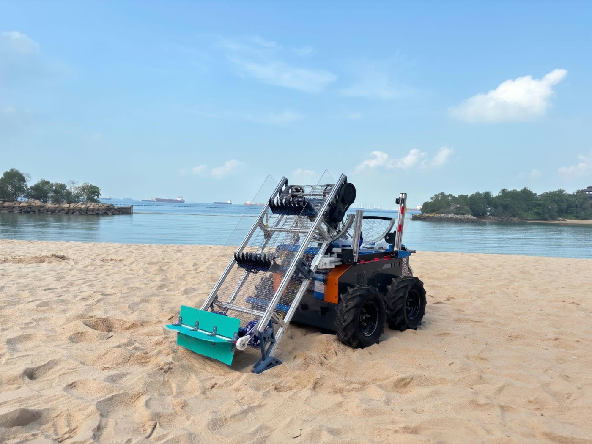

*Figure 3: Final design of BeachBoy.*

The module works in two stages:

1. **Lift.** The conveyor lifts debris up. Loose sand falls through its meshed belt.
2. **Separate.** The trommel half-drum, here "the half-drum", rocks the load against its 5 mm mesh. The purpose is to remove any remaining wet sand through impact and agitation.

Sand falls through onto the collection tray. The debris continues into the bin. Storage is not a stage.

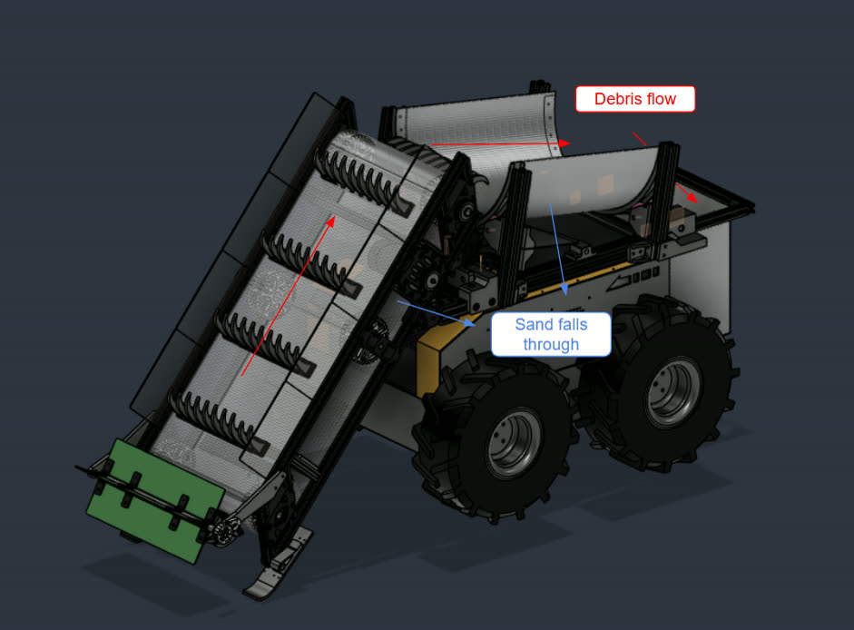

*Figure 4: Initial CAD of the module, with the debris and sand paths annotated.*

The concept is the team's answer to two gaps in existing systems:

| Gap | Name | Design answer | Source |
|---|---|---|---|
| Gap 1 | Maintainability | Modularity: every subsystem comes off with quick-release pins | Report Sections 1.2.1, 2.1 |
| Gap 2 | Wet sand | The half-drum rocks the load against its mesh | Report Sections 1.2.2, 2.1 |

Source: Report Section 2.1, Figures 3 and 4.

## 3.2 Carrier

The carrier is a Botsync Copernicus differential-drive base (report reference [16]). Two 4040 aluminium extrusion payload rails sit on top of the base.

The carrier and the module have separate batteries. The carrier's LiFePO4 pack powers the wheel drives. The module's 24 V sodium-ion pack powers everything else.

The report states that the fully electric servo drivetrain answers the contractor's pain point on hydraulic malfunctions. At B5.0, the machine stayed below 60 dB(A) at 1 m while it traversed, with the conveyor and the half-drum running (D3, Report Table 10).

The table gives the carrier values.

| Item | Value | Source |
|---|---|---|
| Base | Botsync Copernicus, differential drive | Report Section 2.2.1 |
| Payload rails | 2, 4040 aluminium extrusion, top-mounted | Report Section 2.2.1 |
| Battery | LiFePO4 pack | Report Section 3.2 |
| Wheel drives | 2 Trumman EV servo drives, for the left and right wheel groups | Report Appendix F.3 |
| Drive motor rating | 8 A continuous, with higher transient draw on rough terrain and during zero-radius turns | Report Appendix G |
| Manual control | Wireless controller | Report Appendix F.4 |
| Mobility check | At B3.0b, moves with a 10 kg payload, with some impeding of motion when turning in the sandpit. Not tested with a full bin | Report Table 7, Appendix E.4 |
| Noise | At B5.0, below 60 dB(A) at 1 m while traversing, with the conveyor and the half-drum running | Report Table 10 |

Source: Report Sections 2.2.1, 3.2, 4.1.2 and 4.1.4, Appendices E.4, F and G.

## 3.3 Conveyor

As the machine drives, hooked spokes on a mesh belt lift debris and the sand around it to the half-drum.

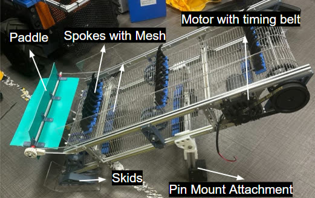

*Figure 5: Conveyor.*

### 3.3.1 Skid

Skids ride ahead of the spokes and set the nominal digging depth at 10 mm. This depth is enough to get a spoke under debris that is on or just below the surface.

The skid height sets the depth, and the depth sets the load. The depth is the 60 mm spoke-tip reach minus the 50 mm skid height:

$$d = 60 - 50 = 10\ \text{mm}$$

The team locked the skids against pivoting at B2.0 because free skids blocked forward motion. The team widened the skid contact area at B4.0 because the skid dug in during reverse and turns.

In field tests, the beach sand had a lower bearing capacity than the sandpit. As a result, the skid sank and built up sand ahead of it until it stopped forward motion (Report Section 4.2).

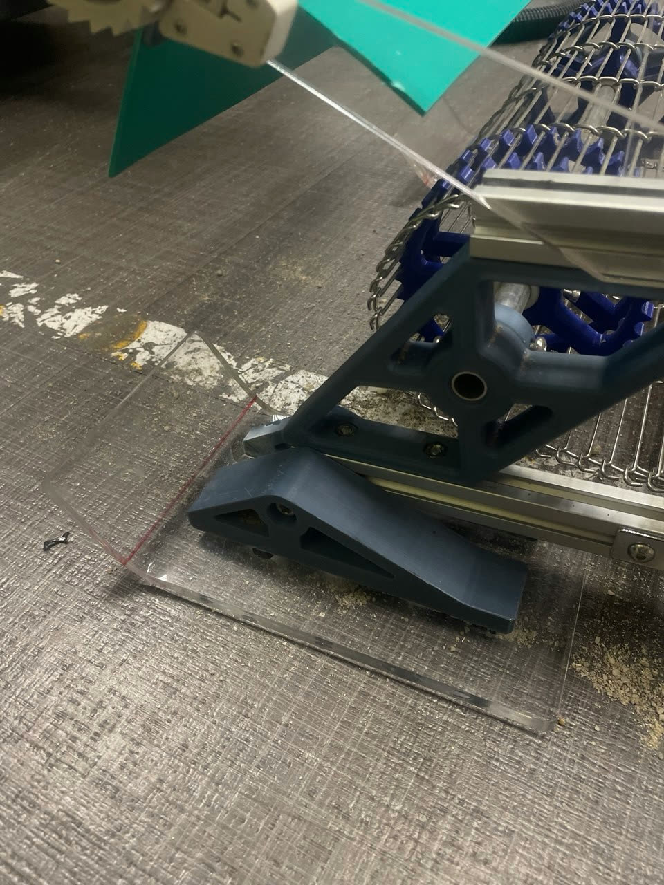

*Figure 6: Skid.*

### 3.3.2 Spokes and belt

Each spoke gets under an item and holds it during the climb. The belt is 35 cm wide and has a 10 mm aperture, so loose sand drops out as the belt rises.

The clear gap between spokes is 22 mm. A 10 mm mesh strip across the spoke row stops small items from falling through. Report Appendix H.5 states that a 10 mm aperture retains most compact small items. The team chose the strip because a halved spoke pitch would double the spoke count and the digging load.

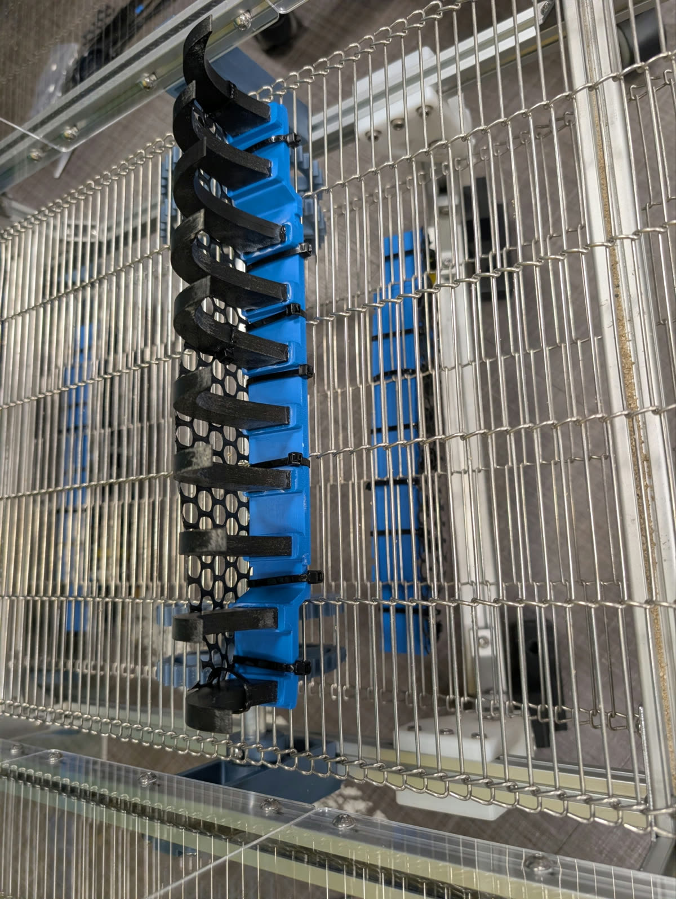

*Figure 7: Spokes with mesh.*

### 3.3.3 Drive

A 24 V, 40 W geared motor turns the axle through an S5M timing belt at 3:1.

Two lower bounds set the ratio:

- The torque bound is 2.93.
- The release bound is 2.92.

The team chose 3:1 because it is the smallest whole-number ratio above both bounds. With 3:1 fitted, the conveyor did not stall in either bench session (B3.0, B4.0).

The speed check is an open item. The values for this check do not agree:

- Report Table H.1 gives a 105 mm drive pulley, and Report Appendix H.3 uses about 109 mm.
- Report Appendix H.3 gives a carrier speed bound of about 0.15 m/s and a field pass speed of 0.21 m/s.
- Report Appendix H.3 gives the horizontal belt speed as 0.23 / i m/s, and Report Table H.4 gives 0.168 m/s at 3:1.
- Report Appendix H.7 states that the carrier speed was not recorded.

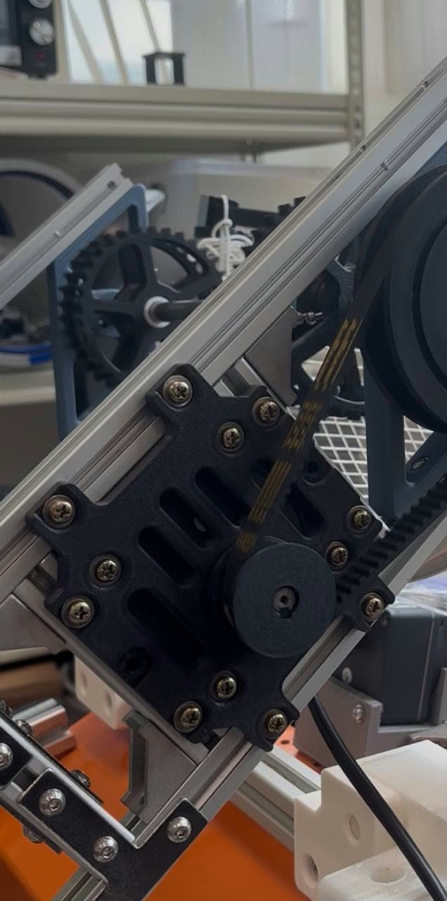

*Figure 8: Motor with timing belt.*

### 3.3.4 Mount

Two 10 mm quick-release pins hold the conveyor on, so an operator can lift it from the machine without tools (D7).

In field tests, a jammed conveyor "folded back on its pivot" and stalled the machine (Report Section 4.2).

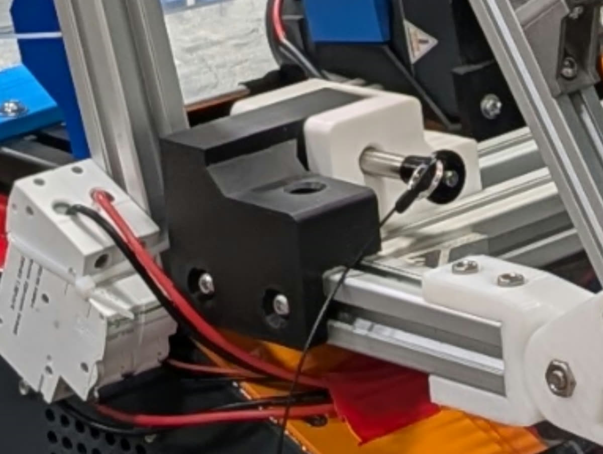

*Figure 9: Conveyor mount.*

### 3.3.5 Front paddle

The spokes tend to push larger items forward instead of lifting them. The ratcheting front paddle passively rotates counter-clockwise only. This rotation lets debris in, and the paddle blocks the items from moving back out while the spokes collect them.

The team added the front paddle at B4.0. At B5.0, the team replaced its flaps with rubber sheets because it jammed debris at the intake. In field tests, medium debris intake rose with the front paddle fitted, but the conveyor jammed more easily (Report Section 4.2).

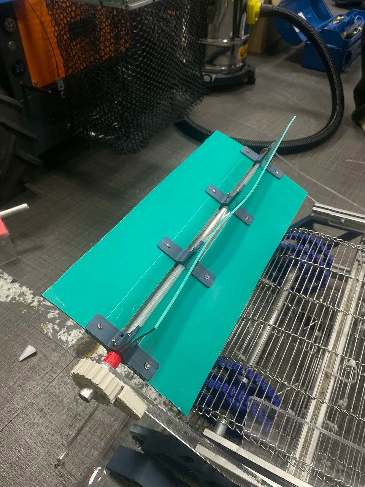

*Figure 10: Front paddle.*

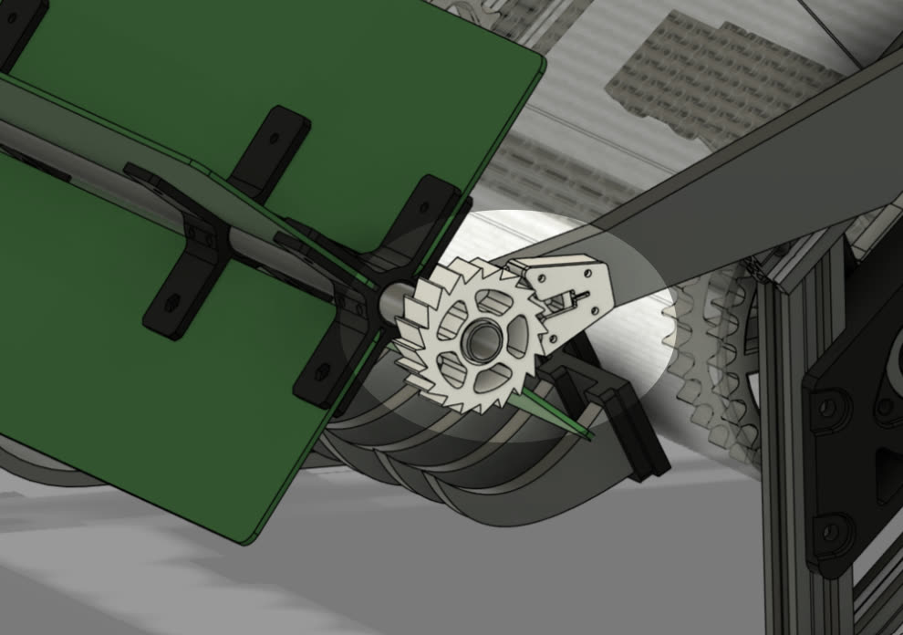

*Figure 11: Ratchet mechanism to prevent items from pushing out.*

### 3.3.6 Specification

The table gives the conveyor values. A row states a build only where the report states one. Report Appendix H.7 states that the digging factors and cohesion are bracketing assumptions, so the loads are design scenarios and not measured belt forces. It also states that the tip reach and the incline should be checked from CAD.

| Part | Item | Value | Source |
|---|---|---|---|
| Frame | Length, B3.0 onward | 1020 mm | Report Table H.1 |
| Frame | Incline | 40°, measured on the assembly | Report Table H.1 |
| Frame | Panels | Acrylic, not present at the transfer to the half-drum | Report Section 4.2 |
| Skid | Height, B3.0 onward | 50 mm | Report Table H.1 |
| Skid | Nominal digging depth | 10 mm | Report Appendix H.1 |
| Skid | Estimated load at this depth, with the assumed 5 N lift allowance and an assumed 1 kPa cohesion | 20.3 to 36.3 N | Report Table H.2 |
| Skid | Sand lifted per metre, at an assumed sand density of 1900 kg/m³ | 3.5 L / 6.7 kg | Report Tables H.1, H.2 |
| Spoke | Pitch / thickness | 30 / 8 mm | Report Table H.1 |
| Spoke | Clear gap | 22 mm | Report Appendix H.5 |
| Spoke | Tip reach below skid datum | 60 mm | Report Table H.1 |
| Spoke | Mesh strip aperture | 10 mm | Report Appendix H.5 |
| Belt | Width | 350 mm | Report Table H.1 |
| Belt | Mesh aperture | 10 mm | Report Table H.1 |
| Drive | Motor | 24 V, 40 W, geared | Report Section 2.2.2 |
| Drive | Motor speed / continuous torque | 120 rpm / 3.236 N·m (33 kgf·cm) | Report Table H.1, Appendix H |
| Drive | Duty | 90% | Report Section 3.2 |
| Drive | Timing belt / ratio | S5M / 3:1 | Report Section 2.2.2 |
| Drive | Efficiency | 0.90, assumed | Report Table H.1 |
| Drive | Lower bounds on ratio | 2.93 torque, 2.92 release | Report Appendix H.3 |
| Drive | Continuous belt force at 3:1 | 166.4 N | Report Table H.4 |
| Drive | Belt speed at 3:1 | 0.220 m/s | Report Table H.4 |
| Drive | Speed check | Open item | Report Appendices H.3, H.7 |
| Mount | Quick-release pins | 2, 10 mm | Report Section 2.2.2 |
| Front paddle | Rotation | Passive, counter-clockwise only, by ratchet | Report Section 2.2.2 |
| Front paddle | Flaps, B5.0 | Rubber sheets | Report Tables 9, H.7 |

Source: Report Section 2.2.2, Figures 5 to 11, Sections 3.1.1, 3.2, 4.1 and 4.2, Appendix H.

## 3.4 Half-drum

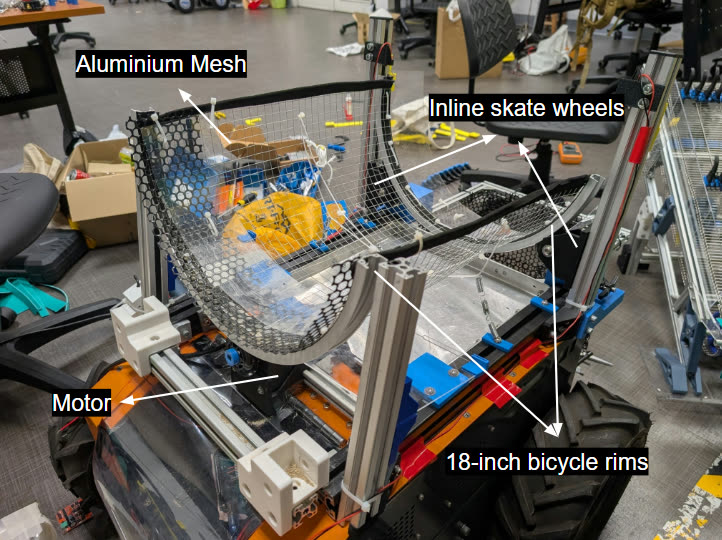

*Figure 12: Trommel half-drum subsystem.*

Flat vibrating screens blind on damp material (report reference [17]). Trommels keep their holes clear by rotation. A rotating drum in Semester 1 tests separated wet sand well, but space constraints led to a change to a U-shaped half-drum.

A motor drives the half-drum by friction. The drive runs at about a quarter of the speed at which the load would stick to the mesh:

$$\frac{\omega}{\omega_c} = 0.24$$

Two springs at the midpoint of the half-drum give additional downforce. The motor can supply 1.8 times the worst-case torque, at an assumed 50% efficiency. The team did not measure the grip at the contact. Report Appendix D.5 states that the spring force and the friction coefficient are not measured.

The half-drum rocks between two normally closed limit switches and coasts for 150 ms at each end. A polycarbonate sheet over the front face of the half-drum shields the motor from sand. At B5.0, the team reduced this sheet to the smallest surface that still shields the motor.

The table gives the half-drum values.

| Item | Value | Source |
|---|---|---|
| Form | U-shaped rocking half-drum | Report Section 2.2.3, Table 4 |
| Mesh | Aluminium, 5 mm | Report Section 2.1, Figure 12 |
| Structure | Bicycle rim, with inline skate wheels sized to the rim channel | Report Table 4 |
| Mesh radius | 196.5 mm, measured | Report Table D.1 |
| Radius over rim flanges | 209.5 mm, measured | Report Table D.1 |
| Drive type | Friction drive on springs | Report Table 6 |
| Springs | 2, at the midpoint of the half-drum | Report Section 2.2.3 |
| Drive wheel diameter | 64 mm | Report Table D.1 |
| Motor | 100 rpm, 40 W, 24 V | Report Table D.1 |
| Current per motor | 1.67 A, within the driver channel rating of about 7 A | Report Appendix D.6 |
| Limit switches | 2, normally closed | Report Section 3.2 |
| Coast at each end | 150 ms | Report Section 3.2 |
| Rocking period | 0.943 s, timed from bench video | Report Table D.1 |
| Stroke angle | 46°, an upper bound that ignores the coast | Report Table D.2 |
| Loaded mass | 2 kg, team estimate | Report Table D.1 |
| Half-drum speed | 16.3 rpm (15.3 rpm if the contact radius is 209.5 mm) | Report Table D.2 |
| Critical speed | 67.5 rpm | Report Table D.2 |
| Fraction of critical speed | 0.24 | Report Table D.2 |
| Motor shaft torque demand | 1.06 N·m worst case, 0.53 N·m nominal | Report Table D.3 |
| Available torque | 1.91 N·m at an assumed 50% efficiency | Report Table D.4 |
| Torque margin, worst case | 1.8 at an assumed 50% efficiency | Report Table D.4 |
| Grip at the contact | Not measured | Report Appendix D.5 |
| Motor shield | Polycarbonate sheet over the front face, reduced at B5.0 | Report Tables 6, 9 |

Source: Report Sections 2.1, 2.2.3, 3.1.2 and 3.2, Figure 12, Tables 6 and 9, Appendix D.

## 3.5 Tray and bin

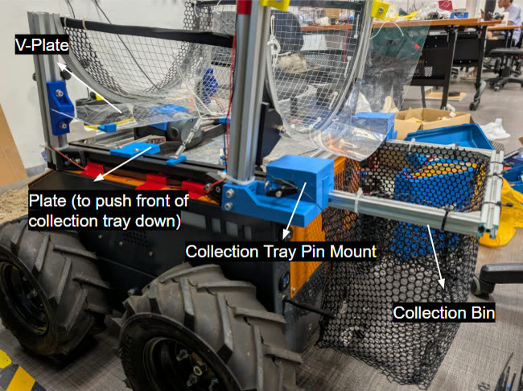

*Figure 13: Collection tray & bin.*

The aluminium collection tray collects separated sand. A meshed bin at the back of the machine collects debris. The tray and the bin are a connected unit that slides out through the back of the machine.

An acrylic V plate keeps sand off the motor. Two 10 mm quick-release pins at the rear and flat PETG pushers at the front hold the unit in place.

At B3.0, the bin bent back under the 10 kg payload. At B4.0, the team moved the pins to the rear and added the pushers. Report Appendix E.2 states that this problem came from how the unit pivoted on its mount, not from the mount's strength.

The calculation shows that one 3D-printed PETG mount part would hold 23 times the design load if it carried all 98.1 N. The report assumes the PETG strength. The team did not test it. The unit was not tested with a full bin, and the mass of the empty unit is unknown (Report Appendix E.4).

At B5.0, the team reduced the V plate to the smallest surface that still shields the motor, because sand clumped on it (Report Table 9). In field tests, most of the collected sand settled on the V plate and the tray. This result still misses the sand separation threshold (D2, Report Section 4.2).

The table gives the tray and bin values.

| Part | Item | Value | Source |
|---|---|---|---|
| Collection tray | Size | 335 × 338 × 25.4 mm, measured | Report Table E.1 |
| Collection tray | Material | 1 mm aluminium | Report Table E.1 |
| Collection tray | Volume | About 2.9 L at the brim | Report Appendix E.4 |
| Bin | Type | Meshed, at the back of the machine | Report Section 2.2.4 |
| Bin | Design payload | 10 kg | Report Table E.1 |
| V plate | Material | 2 mm acrylic | Report Table E.1 |
| V plate | Angle | About 10° | Report Table E.1 |
| V plate | Sand slides only if the friction coefficient is below | 0.18, friction coefficient not measured | Report Table E.3, Appendix E.4 |
| Pins | Quick-release | 2 × 10 mm diameter, stainless steel, each through two PETG parts | Report Table E.1 |
| Pushers | Type | Flat PETG, at the front | Report Section 2.2.4 |
| Mount part | Section / thickness along the pin | 38 × 38 mm / 22 mm | Report Table E.1 |
| Mount part | Print settings | 2 wall loops (0.45 mm), 25% infill | Report Table E.1 |
| Mount part | Assumed strength | 30 MPa tensile, 17.3 MPa shear | Report Appendix E.2 |
| Mount part | Lowest failure load, hole crushing | 2.29 kN | Report Table E.2 |
| Mount part | Margin, load shared | 93 | Report Table E.2 |
| Mount part | Margin if one part takes all 98.1 N | 23 | Report Table E.2 |

Source: Report Sections 2.2.4, 3.1.3, 4.1.3 and 4.2, Figure 13, Appendix E.

## 3.6 Workflow fit

The system is meant to work alongside the contractor's tractors, not replace them. The contractor's sieves still handle the dry upper beach. The system takes over the wet band, which is the wet intertidal band that workers now clear by hand.

The BeachBoy operates below the D3 noise threshold. The report states that this gives the contractor more time to clean the beaches.

| Beach zone | Current method | Intended method | Source |
|---|---|---|---|
| Dry upper beach | Tractor-towed sieves | Tractor-towed sieves | Report Sections 1.1, 2.3 |
| Wet band | Workers, by hand | BeachBoy | Report Section 2.3 |

### 3.6.1 Shift procedure

Figure 14 shows the shift procedure. The procedure uses two workers. Do steps 1 to 3 at the same time. Do the remaining steps in sequence.

1. Worker 1: Drive the BeachBoy along the wet band by remote control.
2. Worker 2: Walk alongside the BeachBoy.
3. Worker 2: Clear the jams.
4. Check the bin.
   - If the bin is full, do step 5.
   - If the bin is not full, do step 9.
5. Slide the collection tray out of the BeachBoy.
6. Empty the bin into the utility vehicle.
7. Tip the sand back onto the beach.
8. Go to step 1.
9. Check the time.
   - If the shift is not at its end, go to step 1.
   - If the shift is at its end, do step 10.
10. Pull the quick-release pins on the conveyor.
11. Pull the quick-release pins on the half-drum.
12. Pull the quick-release pins on the collection tray.
13. Clean each subsystem.
14. Do the maintenance on each subsystem.

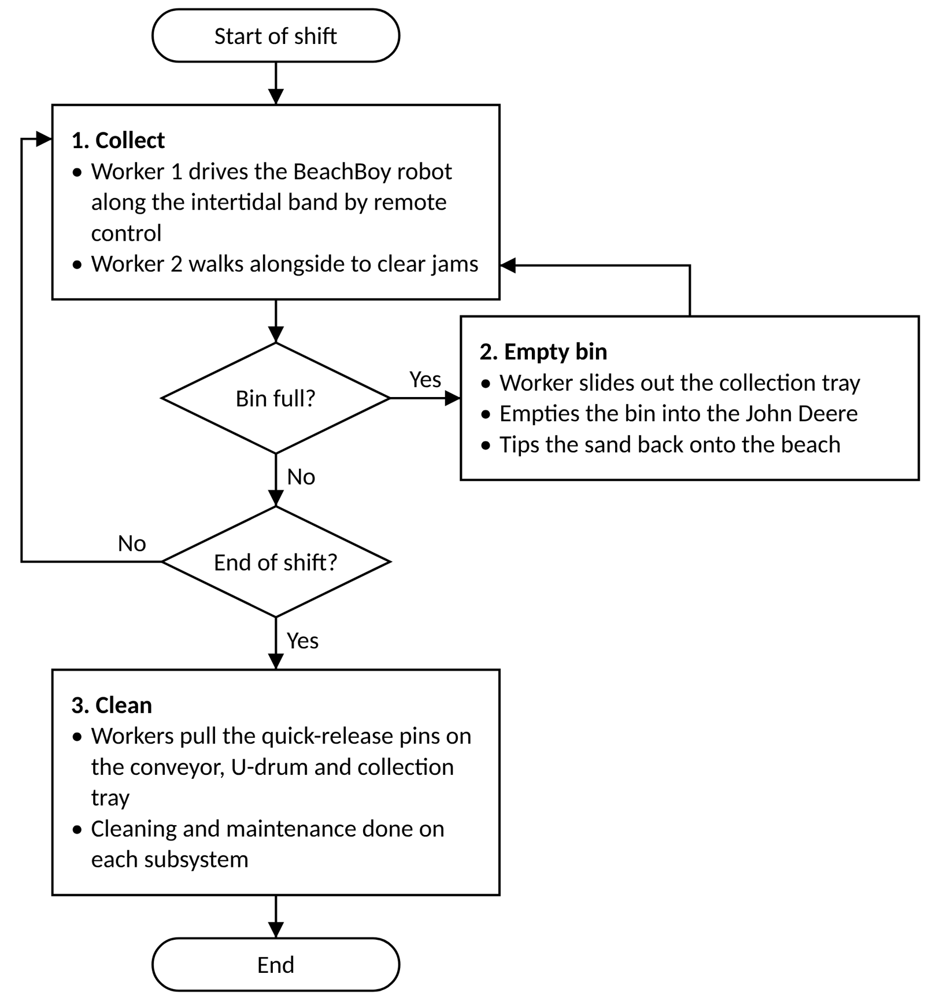

*Figure 14: Flowchart of BeachBoy workflow.*

In Figure 14, "U-drum" means the half-drum. The vehicle that Figure 14 names by brand is the utility vehicle.

In field tests, the clear-out took 5.23 minutes with two people and hand tools only, which met D7 (Report Section 4.2).

Source: Report Sections 1.1, 2.3 and 4.2, Figure 14.

[Previous: Section 2](02-requirements.md) · [Contents](../README.md) · [Next: Section 4](04-electrical.md)
