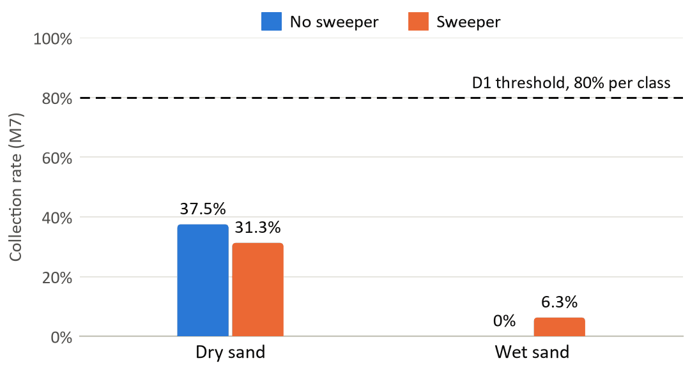
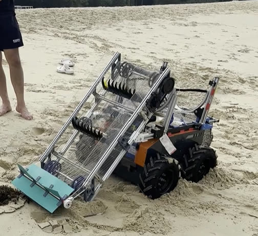

# 4. Development and Tests
[Contents](../README.md) · [Previous](03-electrical.md) · [Next](05-calculations.md)

## 4.1 Build iterations

Build | Changed | Fixed | New problems
---|---|---|---
B1.0 | Free-pivoting 7 cm skids. Direct 1:1 drive. 35 cm mesh belt, printed spokes. Angle 40°. | Long items collected (D1, partly). | Skids block forward motion. Spokes cannot reach digging depth: small, medium and flat items missed. Motor stalls. Debris not handed into the drum.
B2.0 | Bucket scoops and handoff brush tried, rejected. Skids locked. | Skids no longer block (D6, partly). | Scoops stall the motor. Small and flexible items escape past the brush.
B3.0 | Skids cut to 5 cm. Drive raised to 3:1. Conveyor lengthened. | No stalls through bench test 1. Transfer reached 87.5% dry and 78.6% wet. Long items pass intake (D1, partly). | Small rigid items slip between spokes. Large rigid items ride spoke tips. Flat items pushed ahead, worse in damp sand.

*Table 3: Conveyor.*

Build | Changed | Fixed | New problems
---|---|---|---
B0.0 | Printed 28 cm rim. Castors. Friction drive. | Nothing yet. | Drum drifts. Drum too small for the belt.
B1.0 | Bicycle rim. Printed castors. | Rim wider than the belt. | Castors loose. Rim shifts.
B2.0 | Inline skate wheels. | Rim holds its line. | Brush does not guide debris.
B3.0 | Top half removed. Capstan drive, limit switches. GT2 belt rejected. | Debris lands on mesh, none lost through it (D2, partly). | Sand over the half-drum motor. Capstan string loses tension.

*Table 4: Trommel half-drum.*

Build | Changed | Fixed | New problems
---|---|---|---
B3.0 | V plate onto aluminium tray. Tray and bin one unit. Front quick-release pins. | Nothing yet. | Bin bends back under the 10 kg payload.
B4.0 | Pins moved to the rear. Pushers added. | Bin holds, no tray sag (D4, partly). Detaches by hand (D7, partly). | None recorded.

*Table 5: Collection tray and bin.*

Build videos: [intake](https://youtu.be/wSfeeXAeOcA), [skids](https://youtube.com/shorts/mkiJaTSyaQo), [stall](https://youtube.com/shorts/ne3DPbplYf0), [handoff](https://youtube.com/shorts/0ZMXIrph8wY), [castors](https://youtu.be/yAEa0tZkHo4), [scoops](https://youtube.com/shorts/w20crV7bGKU), [belt](https://www.youtube.com/shorts/GvZB0iGH3Iw). Test videos: [bench 1](https://youtu.be/JEZX-O-lJ6w), [bench 2](https://youtu.be/uszukNu2L7s), [road](https://www.youtube.com/shorts/zNM9AM_rsPk), [sand](https://www.youtube.com/shorts/4MD0mDPPx_M).

Source: Report 3.1.

## 4.2 Test programme

Tests used the controlled 16-item dataset, one item at a time.

- **Bench, sandpit:** three repetitions dry and three damp, then a timed hand-tool clear-out by two people.
- **Field, Palawan Beach:** dry and wet sand, with and without the front paddle, then a timed clear-out.
- **User:** two contractor workers attempted six tasks unaided. They and the on-site manager answered fixed questions.
- **Gates:** [Section 1.6](01-problem-and-requirements.md#16-progression-gates).

Source: Report 4, App. I.

## 4.3 Bench results

Cells show B3.0/B4.0. Bold: below the 0.80 gate. Void: no valid run. Overall is not gated. "Wet" labels the damp repetitions.

Stage, sand | Small | Medium | Long | Flat | Overall
---|---|---|---|---|---
Intake, dry | **60%**/87% | **42%**/92% | 100%/100% | **75%**/92% | 67%/92%
Intake, wet | 80%/87% | **33%**/92% | 89%/89% | **33%**/**50%** | 58%/79%
Transfer, dry | **67%**/92% | 100%/100% | 89%/89% | 100%/100% | 88%/96%
Transfer, wet | **75%**/92% | 100%/100% | **63%**/**63%** | 100%/100% | 79%/90%
Discharge, dry | Void/100% | 100%/100% | Void/100% | Void/100% | 100%/100%
Discharge, wet | Void/100% | Void/100% | Void/100% | Void/100% | Void/100%

*Figures 16, 17: Per-class rates.*

At B3.0, a clear-out by two people with no power tools passed D7. The team proceeded to field and user testing after the noise and emergency stop checks.

Source: Report 4.1.

## 4.4 Changes after bench sessions

After | Finding | Change
---|---|---
B3.0 | Small rigid items pass between spokes. | Mesh strip across the spokes.
B3.0 | Large rigid and flat items pushed ahead. | Front paddle.
B3.0 | Sand accumulates over the half-drum motor. | Polycarbonate sheet over the half-drum front.
B3.0 | Capstan string will not hold tension. | Belt drive rejected. Friction drive on springs.
B3.0b | Skid digs in during reverse and turns. | Skid area widened.
B4.0 | Front paddle jams debris at intake. | Rubber sheet flaps.
B4.0 | Sand clumps on polycarbonate sheet and V plate. | Reduce both to the smallest surface that shields the motor.

*Tables 6, 8 and 9: Changes.*

## 4.5 Locomotion, noise and emergency stop

Check | Reading | Threshold, met
---|---|---
M9 road, B3.0b | Route completed. Humps crossed with conveyor fitted. | Moves with a 10 kg payload (D4): Yes
M9 sandpit, B3.0b | Forward, reverse and turns traverse the sand. | Same: yes, with some impeding when turning
M8 noise, B5.0 | Stayed below 60 dB(A) at 1 m while traversing, with the conveyor and the half-drum running. | Below 60 dB(A) at 1 m (D3): Yes
M14 emergency stop, B5.0 | Drive, conveyor and half-drum all stopped immediately. | Mechanism stops immediately (D10): Yes

*Tables 7 and 10: Separate checks. The unit was not tested with a full bin (E.4).*

Source: Report 4.1, App. E.4.

## 4.6 Field results

*Figure 18: Collection rate (M7) by condition.*

The field collection rate fell short of the threshold, partly due to conveyor jams at intake. Cells below show no sweeper/sweeper.

Sand | Intake (M2) | Transfer (M3)
---|---|---
Dry | 37.5%/31.3% | 100%/100%
Wet | 31.3%/37.5% | 0%/16.7%

*Figure 19: Intake and transfer by condition.*

Wet transfer was 89.5% on the bench at B4.0. The report states that the gap comes from field conditions:

- The wet band lies on a cross-slope, steeper than anticipated.
- Debris therefore slid sideways off the conveyor before the half-drum.
- The acrylic panels meant to counteract this were not present at that transfer.

The team therefore updated D1.

*Figure 20: BeachBoy on the wet band.*

Metric, sand | Small | Medium | Long | Flat
---|---|---|---|---
Intake, dry | 20.0%/20.0% | 50.0%/75.0% | 33.3%/33.3% | 50.0%/0%
Intake, wet | 20.0%/20.0% | 0%/25.0% | 66.7%/33.3% | 50.0%/75.0%
Transfer, dry | 100%/100% | 100%/100% | 100%/100% | 100%/–
Transfer, wet | 0%/0% | –/0% | 0%/0% | 0%/33.3%
Discharge, dry | 100%/100% | 100%/100% | 100%/100% | 100%/–
Discharge, wet | –/– | –/– | –/– | –/100%

*Figure 21: Rates per debris class.*

In both configurations, beach sand had a lower bearing capacity than the sandpit. The skid therefore sank and accumulated sand until forward motion stopped and the conveyor folded back. The front paddle raises medium intake, but makes jams more likely.

The majority of collected sand settled on the V plate and tray. The report calls this an improvement that still misses D2.

Metric | Dry | Wet | Met
---|---|---|---
M1, wet to dry intake ratio | — | 0.83/1.20 | —
M13, clear-out, two people, hand tools | — | 5.23 min/— | Yes (D7)
M10, locomotion, both configurations | Traversed with some impediment from the conveyor | Same. Wheels dig in and slip. | Yes, with limits (D6)

*Table I.3: Field summary.*

Source: Report 4.2, App. I.

## 4.7 User tests

ID | Operator A | Operator B | On-site manager | Threshold, met
---|---|---|---|---
M11 tasks | 5 of 6 unaided. Needed help on task 4, clear a jam and resume. | 5 of 6 unaided. Needed help on task 2, drive it to the working zone. | — | 5 of 6 unaided (D9): Yes
M12 demand | Mentioned that the bobcat drops debris that workers have to bend for and collect again. With BeachBoy, the bin is simply lifted out, and this is less tiring. | Mentioned that at present, workers spend hours in the sun collecting a lot of debris. With BeachBoy, it drives and collects instead, which is less demanding. | Mentioned that it will be less tiring. Workers do not need to bend and collect debris as much, manually and after the bobcat collects it. | Reported qualitatively as less demanding (D8): Yes

*Table 11: User metrics.*
