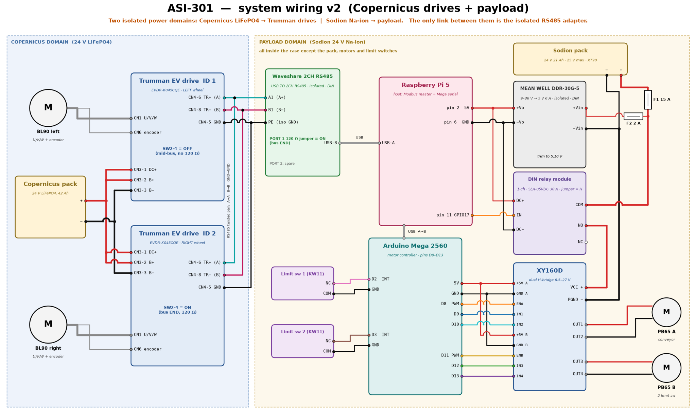

# 4. Electrical System

*ASI-301 Engineering Report · Section 4*

[Previous: Section 3](03-system-design.md) · [Contents](../README.md) · [Next: Section 5](05-development.md)

This section gives the power domains, the control chain, the module electronics, the electronics case and the electrical check. Subsection 4.6 describes the firmware from its source file. [hardware/README.md](../hardware/README.md) lists the engineering files.

## 4.1 Power domains

The machine has two isolated power domains (Figure 15).

| Domain | Label in Figure 15 | Source | Loads |
|---|---|---|---|
| Carrier | Copernicus domain | LiFePO4 pack | Wheel drives |
| Module | Payload domain | 24 V sodium-ion pack | Everything else |

The two domains connect only through an isolated RS485 link, so a payload fault cannot reach the drives (report reference [19]). Figure 15 shows all module electronics inside the case, except the pack, the motors and the limit switches.

*Figure 15: System wiring. Left: carrier power domain and wheel drives. Right: payload power domain, controllers, motor driver and limit switches.*

Figure 15 prints a capacity for the module pack. That value and the energy value in Report Section 3.2 do not agree, so this section gives no capacity or runtime. Refer to 4.7.

Source: Report Section 3.2, Figure 15.

## 4.2 Control

The control chain works as follows:

1. The Raspberry Pi 5 talks to the carrier's servo drives over Modbus RTU.
2. The Raspberry Pi 5 switches the payload relay and supervises an Arduino Mega 2560.
3. The Mega drives the motors.

Modbus RTU is a serial request-response protocol. Here it runs over RS485.

The Mega runs the conveyor at 90% duty. It rocks the half-drum between two normally closed limit switches. It coasts for 150 ms at each end, so the H-bridge never reverses from full power.

The switches are normally closed. If a wire breaks, the Mega reads the break as a press and stops the half-drum. This prevents the half-drum from driving past its end of travel. Subsection 4.6.2 gives the sequence in the firmware.

In test S3 at ASI-B5.0, the robot drive, the conveyor and the half-drum all stopped immediately on emergency stop (Table 10). Figure 15 does not show an emergency stop circuit. Refer to 4.7.

Source: Report Section 3.2, Section 4.1.4, Table 10.

## 4.3 Module electronics

The tables below give the components and connections as Figure 15 labels them. The tables include the carrier components because the RS485 link joins them to the module.

### 4.3.1 Components

| Domain | Component | Data in Figure 15 |
|---|---|---|
| Carrier | Carrier pack ("Copernicus pack") | 24 V LiFePO4, 42 Ah |
| Carrier | Trumman EV drive ID 1 | EVDR-K045CQE, left wheel. SW2-4 OFF: mid-bus, no 120 Ω |
| Carrier | Trumman EV drive ID 2 | EVDR-K045CQE, right wheel. SW2-4 ON: bus end, 120 Ω |
| Carrier | BL90 left and BL90 right | Motors with U/V/W and encoder |
| Module | Module pack ("Sodion pack") | 24 V sodium-ion, 25 V maximum, XT90 |
| Module | Fuse F1 | 15 A |
| Module | Fuse F2 | 2 A |
| Module | MEAN WELL DDR-30G-5 | 9–36 V to 5 V, 6 A, isolated, DIN. Trim to 5.10 V |
| Module | DIN relay module | 1 channel, SLA-05VDC, 30 A, jumper at H |
| Module | Raspberry Pi 5 | Host: Modbus master and Mega serial |
| Module | Waveshare 2CH RS485 | USB TO 2CH RS485, isolated, DIN. Port 1: 120 Ω jumper ON, bus end. Port 2: spare |
| Module | Arduino Mega 2560 | Motor controller, pins D8 to D13 |
| Module | XY160D | Dual H-bridge, 6.5–27 V |
| Module | PB65 A | Conveyor motor |
| Module | PB65 B | Motor with 2 limit switches |
| Module | Limit switch 1 and limit switch 2 | KW11, NC and COM used |

### 4.3.2 Power connections

| From | To | Note |
|---|---|---|
| Carrier pack + and − | Each drive: CN3-1 DC+, CN3-2 B+, CN3-3 B− | Carrier domain |
| Module pack + | F1 15 A, then relay COM | Motor supply path |
| F1 output | F2 2 A, then DDR-30G-5 +Vin | Logic supply path |
| Module pack − | DDR-30G-5 −Vin and XY160D PGND | Common return |
| Relay NO | XY160D VCC + | The relay switches the motor supply |
| DDR-30G-5 +Vo | Raspberry Pi 5 pin 2 (5 V) and relay DC+ | 5 V rail |
| DDR-30G-5 −Vo | Raspberry Pi 5 pin 6 (GND) and relay DC− | 5 V return |

### 4.3.3 Signal connections

| From | To | Link |
|---|---|---|
| Raspberry Pi 5 USB-A | Waveshare USB-B | USB |
| Waveshare A1 (A+) | Drive CN4-6 TR+ (A), both drives | RS485 twisted pair |
| Waveshare B1 (B−) | Drive CN4-8 TR− (B), both drives | RS485 twisted pair |
| Waveshare PE (iso GND) | Drive CN4-5 GND, both drives | RS485 ground |
| Raspberry Pi 5 pin 11 (GPIO17) | Relay IN | Relay control |
| Raspberry Pi 5 USB-A | Mega USB-B | USB |
| Mega 5 V and GND | XY160D +5V and GND, channels A and B | Driver logic supply |
| Mega D8, D9, D10 | XY160D ENA, IN1, IN2 | Channel A |
| Mega D11, D12, D13 | XY160D ENB, IN3, IN4 | Channel B |
| XY160D OUT1, OUT2 | PB65 A | Conveyor motor |
| XY160D OUT3, OUT4 | PB65 B | Motor with limit switches |
| Limit switch 1 NC and COM | Mega D2 and GND | Limit switch input |
| Limit switch 2 NC and COM | Mega limit switch input and GND | Figure 15 shows D3. The firmware uses D7. Refer to 4.7 |

Source: Report Figure 15.

## 4.4 Electronics case

The electronics sit in a removable acrylic case at the front of the chassis. The case keeps out sand (D7).

The electronics case is not sealed. Requirement D5, "Resist salt and wet sand", has the status "Not tested".

[hardware/README.md](../hardware/README.md) lists the case drawings, CAD files and laser-cut files.

Source: Report Section 3.2, Table 2, Table 12.

## 4.5 Electrical check

The check compares the input current of one motor with the driver channel rating.

$$I = \frac{P_{in}}{V} = \frac{40}{24} = 1.67\ \text{A}$$

This value matches the rated 1.7 A per 40 W motor in Report Section 3.2. It is within the driver's channel rating of about 7 A.

Source: Report Appendix D.6, Table D.1, Section 3.2.

## 4.6 Firmware (from the source file)

This subsection does not come from the report. It describes the source file [XY160D_LimitSwitch_Mega.ino](../hardware/firmware/XY160D_LimitSwitch_Mega/XY160D_LimitSwitch_Mega.ino), which runs on the Mega.

### 4.6.1 Pin map

The firmware is the reference for the pin map.

| Mega pin | Connects to | Function | Constant |
|---|---|---|---|
| D8 | XY160D ENA | Speed of motor A, PWM on Timer4C | `ENA` |
| D9 | XY160D IN1 | Direction of motor A | `IN1` |
| D10 | XY160D IN2 | Direction of motor A | `IN2` |
| D11 | XY160D ENB | Speed of motor B, PWM on Timer1A | `ENB` |
| D12 | XY160D IN3 | Direction of motor B | `IN3` |
| D13 | XY160D IN4 | Direction of motor B. This pin also drives the on-board LED | `IN4` |
| D2 | Limit switch 1 NC | One end of motor B travel | `LIMIT1` |
| D7 | Limit switch 2 NC | Other end of motor B travel | `LIMIT2` |
| GND | Limit switch COM (both), XY160D logic GND | Common ground | |
| 5V | XY160D logic +5V | Depends on the check in 4.6.4 | |

In Figure 15, motor A is the conveyor motor. Report Section 3.2 states that the half-drum rocks between the limit switches, so motor B drives the half-drum.

The file sets each channel as follows.

| Speed value | EN | First input | Second input | Result |
|---|---|---|---|---|
| Positive | PWM | HIGH | LOW | Forward |
| Negative | PWM | LOW | HIGH | Reverse |
| 0 | LOW | LOW | LOW | Off (coast) |

### 4.6.2 Behaviour

**Start.** At power-up, the firmware sets both motors off and enables the input pull-ups. It then starts both motors with no command. Motor A runs forward at 230 of 255, and motor B shuttles at 230 of 255. The file calls this value 90%.

**PWM.** The firmware sets Timer4 and Timer1 to prescaler /8. This gives PWM of about 3.9 kHz on D8 and D11. The default is about 490 Hz. A file comment gives the purpose: "Keeps the driver under 10 kHz".

**Limit switch input.** NC connects to the pin and COM connects to GND, with the internal pull-up on. The pin reads LOW in normal operation. It reads HIGH when the switch is hit or when a wire breaks.

The firmware filters each reading.

| Constant | Value | Function |
|---|---|---|
| `HIT_FILTER_US` | 2000 µs | A HIGH reading must hold for this time before it counts as a hit |
| `RELEASE_FILTER_US` | 20000 µs | A clear reading must hold for this time before it counts as a release |
| `REVERSE_PAUSE_MS` | 150 ms | Motor B coasts for this time before it reverses |
| `BACKOFF_TIMEOUT_MS` | 1500 ms | A pressed switch must release within this time after motor B reverses |

**Shuttle.** Motor B has this sequence at a switch:

1. Motor B runs into a switch. The firmware records the direction as the end of that switch.
2. Motor B coasts for 150 ms.
3. Motor B drives in the opposite direction at the same speed.
4. The firmware ignores that switch until motor B reaches the other switch.

The firmware learns the end of each switch from the travel direction, so the two switches can go either way round.

**Motor B stops.** The firmware stops motor B and prints a message in these fault conditions:

- Both switch inputs are active while motor B runs or waits to reverse.
- A switch stays active for more than 1500 ms after motor B starts to back away from it.

After a stop, motor B stays off until the next `b` command or the next reset. Motor A has no switches, and these conditions do not stop it. Only an `a` command with speed 0, the `s` command or a power loss stops motor A.

**Broken wire.** The firmware reads a broken wire as a hit, so the result depends on the state of the switch:

- If the firmware monitors the switch at that time, motor B coasts for 150 ms and reverses. Motor B then stops if the input does not clear within 1500 ms.
- If the firmware ignores the switch at that time, the break has no effect until motor B reaches the other switch. Motor B then stops because both inputs are active.

**Refused command.** A `b` command does not drive motor B into a pressed switch whose end is known. The firmware prints a message and motor B stays off. The firmware assumes that a pressed switch with an unknown end is behind the motor. The 1500 ms check stops motor B if that assumption is wrong.

### 4.6.3 Serial commands

The serial monitor runs at 9600 baud, with the line ending "Newline". The firmware also accepts a carriage return as a line end. It keeps the first 15 characters of a line and discards the rest. Only the first character selects the command.

| Command | Effect |
|---|---|
| `a<speed>` | Sets motor A to the speed. Example: `a150` is forward at 150, and `a-80` is reverse at 80 |
| `b<speed>` | Sets motor B to the speed and starts the shuttle between the switches. Example: `b200` |
| `s` | Stops both motors |
| `?` | Prints the motor speeds and the state of each switch, with its known end |
| A line with any other first character | Prints the list of commands |

The firmware limits speed to the range −255 to 255. A speed of 0 stops that motor. The firmware reads a missing or non-numeric speed as 0.

### 4.6.4 Driver logic supply check

WARNING: DO NOT CONNECT THE MOTOR SUPPLY TO THE MEGA. CONNECT XY160D VCC AND PGND TO THE MOTOR SUPPLY THROUGH A 10–15 A FUSE.

Do this check before you connect the XY160D +5V pins to the Mega. The procedure comes from the firmware file header.

1. Disconnect the logic header from the XY160D.
2. Turn on the motor supply.
3. Measure the voltage between +5V and GND on each channel.
4. If the voltage is approximately 0 V, connect +5V to the Mega 5V pin.
5. If the voltage is approximately 5 V, do not connect +5V.
6. Connect GND to the Mega GND pin in both conditions.

Source: `hardware/firmware/XY160D_LimitSwitch_Mega/XY160D_LimitSwitch_Mega.ino`.

## 4.7 Open items

| Item | Conflict | Status |
|---|---|---|
| Limit switch 2 pin | The firmware uses D7. [XY160D_Mega2560_wiring.png](../hardware/electrical/XY160D_Mega2560_wiring.png) and Figure 15 ([ASI-301_Wiring_v2.png](../hardware/electrical/ASI-301_Wiring_v2.png)) show D3. | Open. The firmware is the reference |
| Module pack capacity | Report Section 3.2 and Figure 15 give values that do not agree. | Open. This section gives no capacity or runtime |
| Emergency stop circuit | Table 10 records the emergency stop result. Figure 15 does not show the circuit. | Open |
| Broken wire response | Report Section 3.2 states that the Mega stops the half-drum. Subsection 4.6.2 gives a different sequence in the firmware. | Open |
| Requirement tag of the case | Report Section 3.2 tags "keeps out sand" with D7. Table 2 gives D7 as shift-end clearing. | Open |

Source: Report Section 3.2, Figure 15, Table 2, Table 10, and the firmware file.

[Previous: Section 3](03-system-design.md) · [Contents](../README.md) · [Next: Section 5](05-development.md)
