# 6. Test and Evaluation

*ASI-301 Engineering Report · Section 6*

[Previous: 5. Development](05-development.md) · [Contents](../README.md) · [Next: 7. Design Calculations](07-calculations.md)

## 6.1 Test programme

After the full system build, the team ran bench, field and user tests. The tests used the controlled 16-item dataset, one item at a time. Each environment depended on a gate from the last environment.

The bench tests took place in a sandpit. Each item went through intake, transfer, separation and discharge three times dry and three times damp. A timed two-person, hand-tool clear-out followed. The team checked noise, emergency stop and locomotion with a 10 kg payload separately.

The field tests took place on Palawan Beach. The team repeated the test in dry and wet sand, with and without the front paddle, and timed the clear-out. Two contractor workers attempted six tasks unaided. They and the on-site manager answered fixed questions.

Test-configuration labels in this section call the front paddle "sweeper". The build and test log (report reference [18]) holds the full test methods, the per-item run grids and the session records.

| Gate | Conditions |
|---|---|
| Bench to field | 1. Intake, transfer and discharge (into bin) rate all at 0.80 per class, dry and wet. 2. Majority of the sand no longer in the half-drum. 3. Debris loss at 0.05 or less. 4. Noise under 60 dB(A). 5. Moves with the bin and a 10 kg payload. 6. Emergency stop stops both drive and payload. |
| Field to pilot | 1. Collection rate at 0.80 or better per class. 2. Locomotion observed in dry and wet sand. |

*Table I.1: Progression gates between environments.*

The mobility check in this section is a check with a 10 kg payload. Report Appendix E.4 states that the unit has not been tested with a full bin (T2).

| Test | Brief description of tests conducted | Environment | Dataset |
|---|---|---|---|
| Bench | Full system test: the 16-item dataset run through intake, transfer, separation and discharge into bin, one item at a time. Three repetitions dry and three damp. One shift-end clear-out done by 2 people with no power tools required. | Sandpit | Controlled |
| Bench | Maintainability: two people clear the packed half-drum to restart-ready with hand tools, timed. | Sandpit | Controlled |
| Bench | Noise: measure the noise level of BeachBoy while it traverses. | Sandpit | Controlled |
| Bench | Emergency stop: test the function of the emergency stop while the entire system runs. | Sandpit | Controlled |
| Bench | Mass: locomotion with 10 kg payload on road and sand. | Sandpit | Controlled |
| Field and user | Full system test: the 16-item dataset run through intake, transfer, separation and discharge into bin, one item at a time. Done in both sand conditions and repeated with the front paddle fitted, then removed. Collection rate calculated from intake and transfer rate. One shift-end clear-out done by 2 people with no power tools required. | Beach | Controlled |
| Field and user | Maintainability: clear-out timed after the wet runs packed the half-drum. | Beach | Controlled |
| Field and user | Task completion and interview: two contractor workers over six tasks unaided, then three fixed questions each. | Beach | Controlled |
| Field and user | Workflow fit: three fixed questions to the on-site manager after watching a full pass. | Beach | Controlled |

*Table I.2: The test programme.*

Source: Report Chapter 4 introduction, Appendix I, Tables I.1 and I.2, Appendix E.4.

## 6.2 First bench session, ASI-B3.0

### 6.2.1 Results

The [first session](https://youtu.be/JEZX-O-lJ6w) put the assembled machine into the sandpit. The team ran the full 16-item dataset through intake, transfer and discharge, one item at a time. The session used three repetitions dry and three damp.

Two people did one shift-end clear-out with no power tools. This result passes D7: shift-end clearing by two people with hand tools.

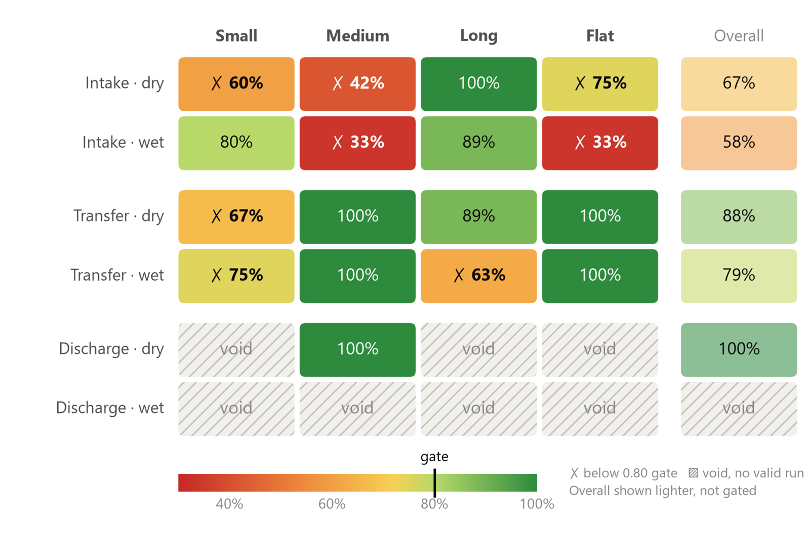

*Figure 16: Per-class intake, transfer and discharge rates at ASI-B3.0, against the 0.80 gate.*

| Stage and sand | Small | Medium | Long | Flat | Overall |
|---|---|---|---|---|---|
| Intake, dry | 60% (below) | 42% (below) | 100% | 75% (below) | 67% |
| Intake, wet | 80% | 33% (below) | 89% | 33% (below) | 58% |
| Transfer, dry | 67% (below) | 100% | 89% | 100% | 88% |
| Transfer, wet | 75% (below) | 100% | 63% (below) | 100% | 79% |
| Discharge, dry | Void | 100% | Void | Void | 100% |
| Discharge, wet | Void | Void | Void | Void | Void |

In the table, these labels apply:

- "Below" marks a rate below the 0.80 gate.
- "Void" means no valid run.
- The Overall column is not gated.

The report text calls the bench repetitions dry and damp. Figures 16 and 17 label them dry and wet.

Source: Report Section 4.1.1, Figure 16.

### 6.2.2 Findings and iterations

The findings directed the iterations before the second bench test.

| Finding | Iteration made |
|---|---|
| Small rigid items pass between the spokes. 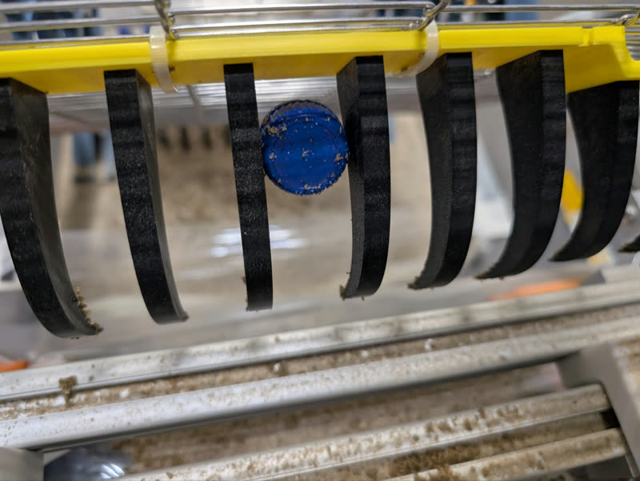 | Mesh strip across the spokes. 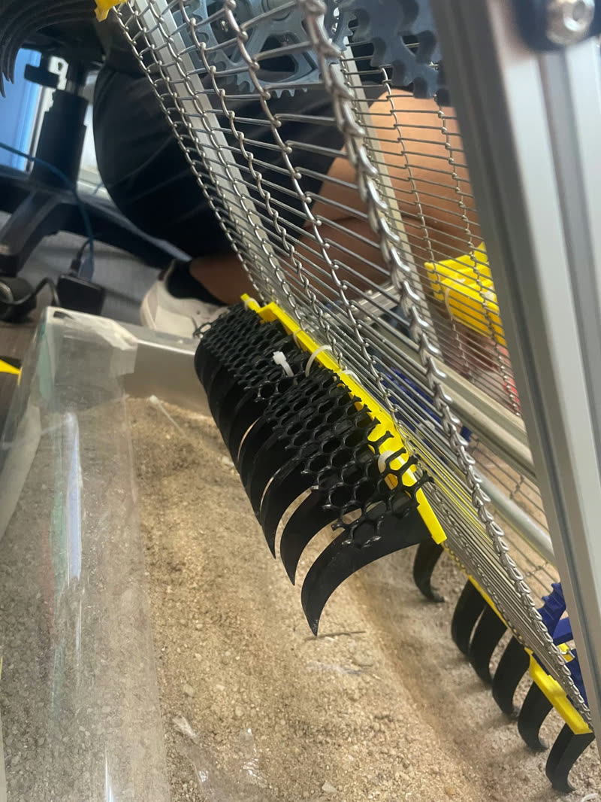 |
| Large rigid and flat items pushed ahead of the intake. 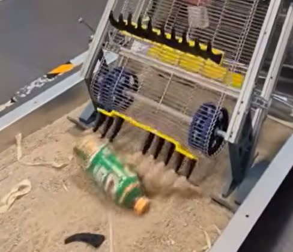 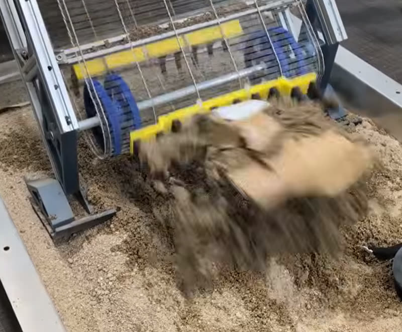 | Front paddle at the intake front. 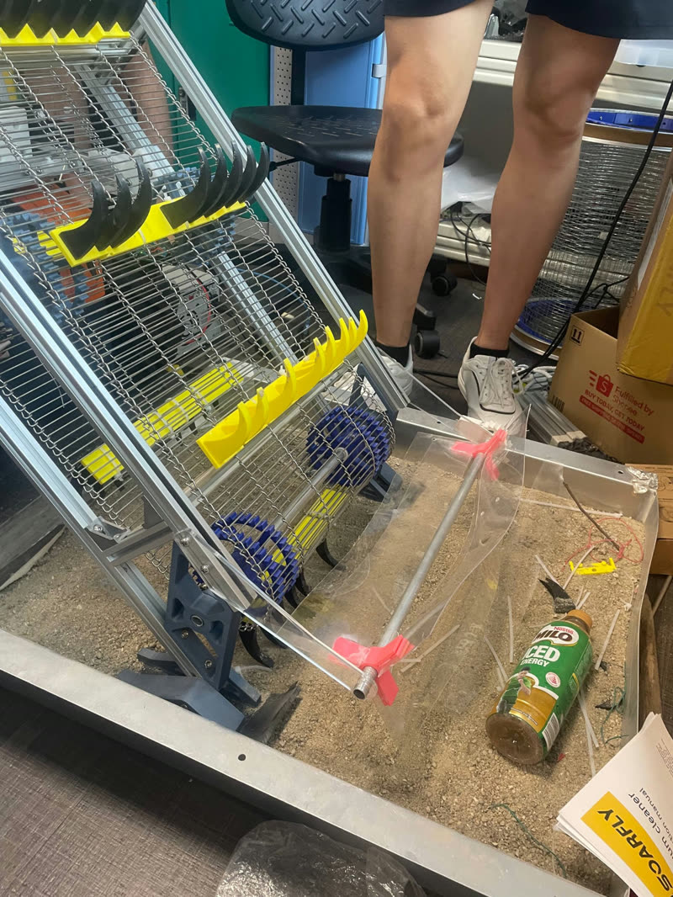 |
| Sand accumulates over the half-drum motor. 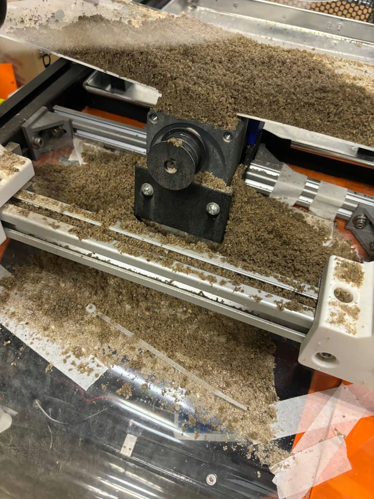 | Polycarbonate sheet over the half-drum front face. 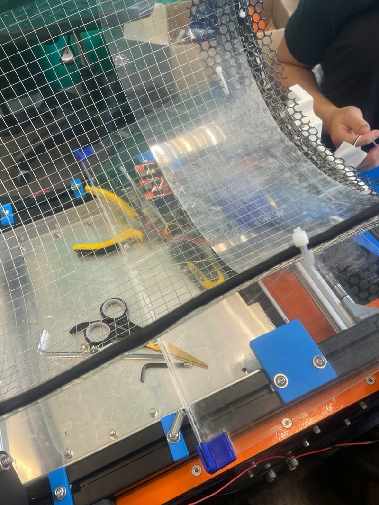 |
| Capstan string will not hold tension. 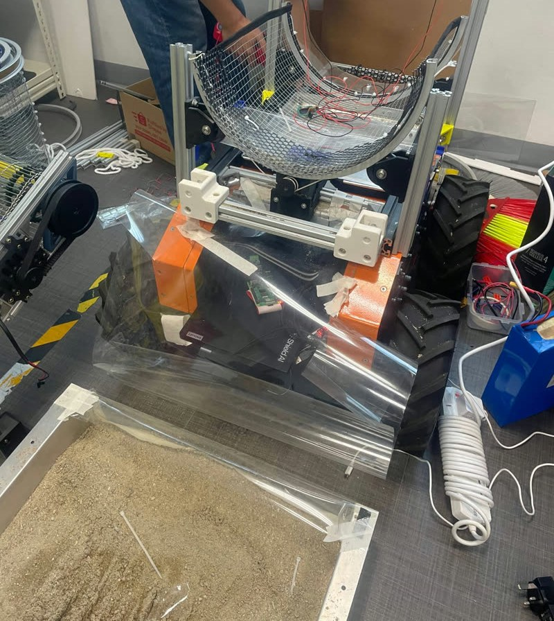 | Belt drive trialled and rejected. Friction drive on springs fitted. 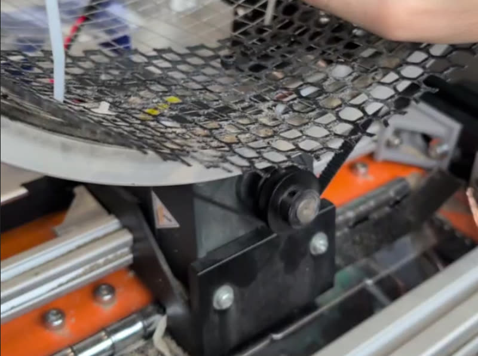 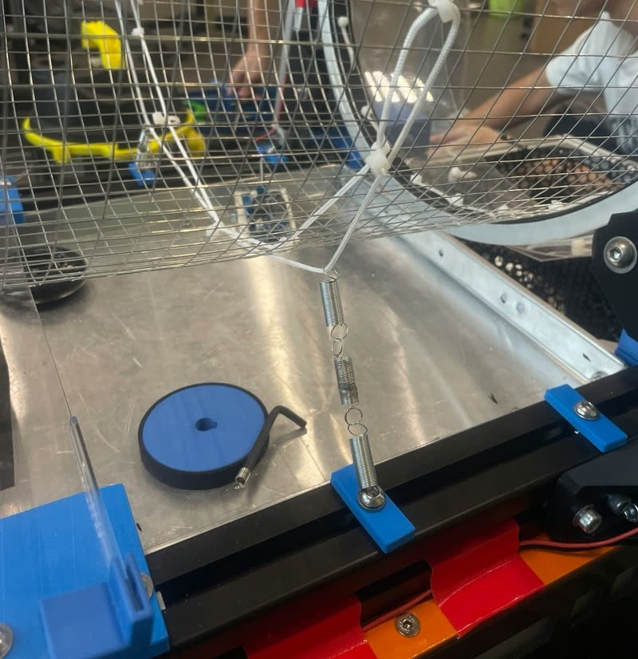 |

*Table 6: Improvements made between ASI-B3.0 and ASI-B4.0.*

Source: Report Section 4.1.1, Table 6.

## 6.3 Locomotion check, ASI-B3.0b

The team tested forward, reverse, left turn and right turn on each terrain with the 10 kg payload.

| ID | Metric | Terrain | Reading | Threshold | Met |
|---|---|---|---|---|---|
| M9 | Mobility with a 10 kg payload | Road, EA to E2A | Route completed with the 10 kg payload. Humps crossed with the conveyor fitted. [Road locomotion video log](https://www.youtube.com/shorts/zNM9AM_rsPk). | Moves with a 10 kg payload (D4) | Yes |
| M9 | Mobility with a 10 kg payload | Sandpit | Forward, reverse and turning motion all traverse the sand. [Sand locomotion video log](https://www.youtube.com/shorts/4MD0mDPPx_M). | Moves with a 10 kg payload (D4) | Yes. It moves, with some impeding of motion when turning. |

*Table 7: Locomotion results at ASI-B3.0b.*

| Finding | Iteration made |
|---|---|
| Skid digs into the sand in reverse and in turns, and sand gets onto it. Only the front of the skid curves upwards. | Skid area widened to distribute weight better, so less sand piles on it. 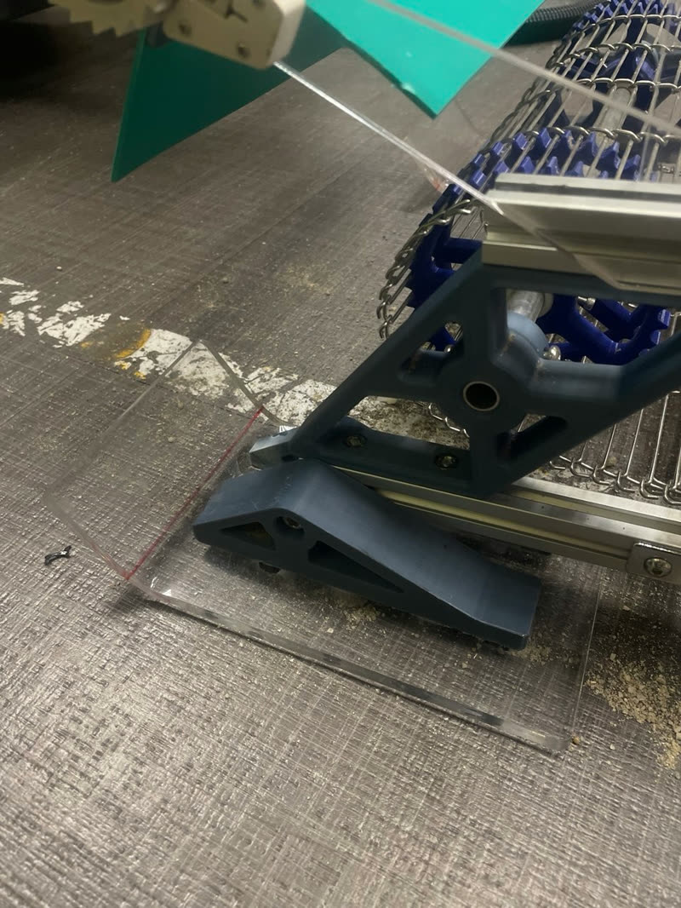 |

*Table 8: Improvements made after the locomotion check.*

Source: Report Section 4.1.2, Tables 7 and 8.

## 6.4 Second bench session, ASI-B4.0

### 6.4.1 Results

The [second session](https://youtu.be/uszukNu2L7s) repeated the first with 16 items, one at a time. The session used three repetitions dry and three damp, and one clear-out. The session included the four changes that the report states before this session.

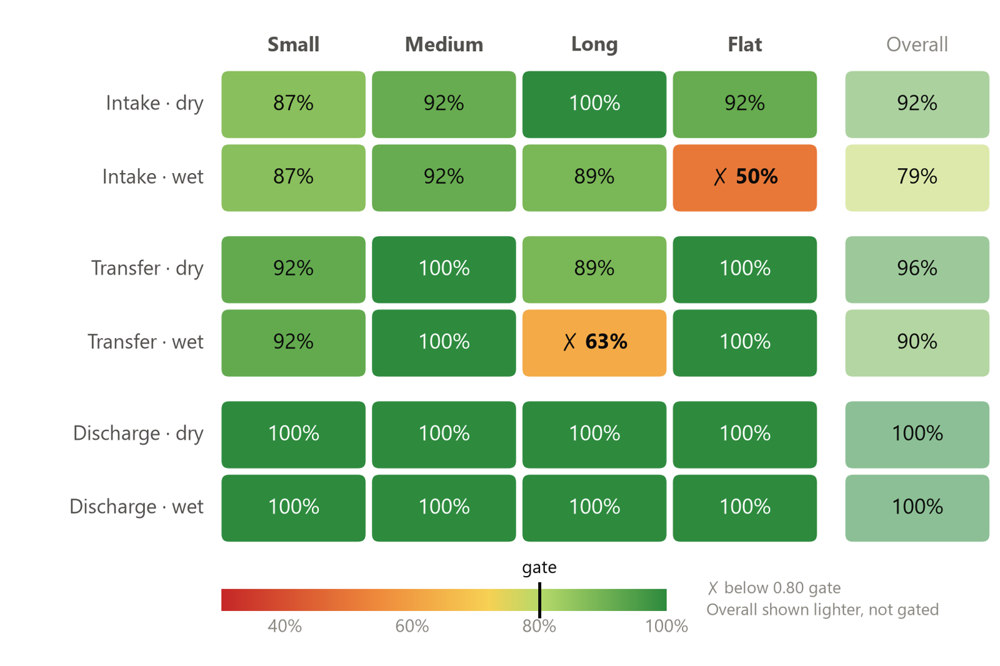

*Figure 17: Per-class intake, transfer and discharge rates at ASI-B4.0, against the 0.80 gate.*

| Stage and sand | Small | Medium | Long | Flat | Overall |
|---|---|---|---|---|---|
| Intake, dry | 87% | 92% | 100% | 92% | 92% |
| Intake, wet | 87% | 92% | 89% | 50% (below) | 79% |
| Transfer, dry | 92% | 100% | 89% | 100% | 96% |
| Transfer, wet | 92% | 100% | 63% (below) | 100% | 90% |
| Discharge, dry | 100% | 100% | 100% | 100% | 100% |
| Discharge, wet | 100% | 100% | 100% | 100% | 100% |

"Below" marks a rate below the 0.80 gate. The Overall column is not gated.

Wet flat intake (50%) and wet long transfer (63%) stayed below the 0.80 gate. All other per-class rates in Figure 17 are at 87% or above. The team proceeded to field and user testing after the noise and emergency stop checks.

Source: Report Section 4.1.3, Figure 17.

### 6.4.2 Findings and iterations

The team made further improvements based on findings during the test.

| Finding | Iteration made |
|---|---|
| Front paddle jams debris at the intake. 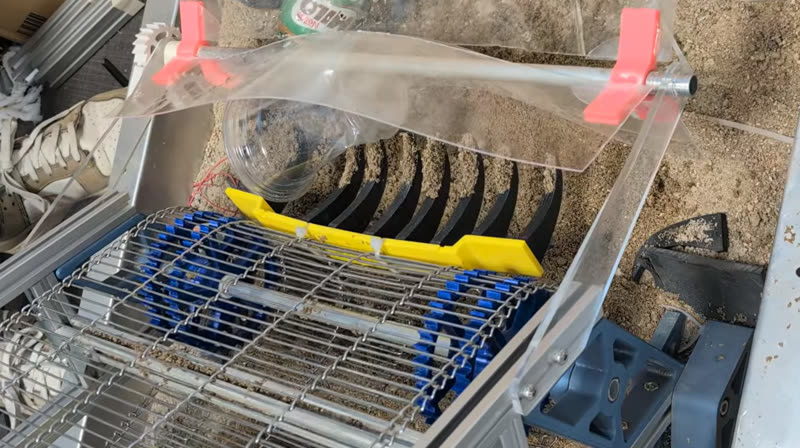 | Flaps replaced with rubber sheets. 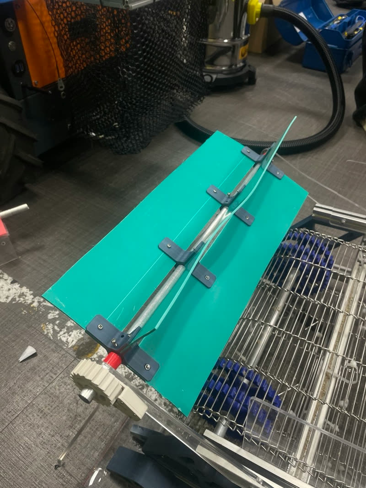 |
| Sand clumps on the polycarbonate sheet and the V plate.  | Reduce both to the smallest surface that still shields the motor. 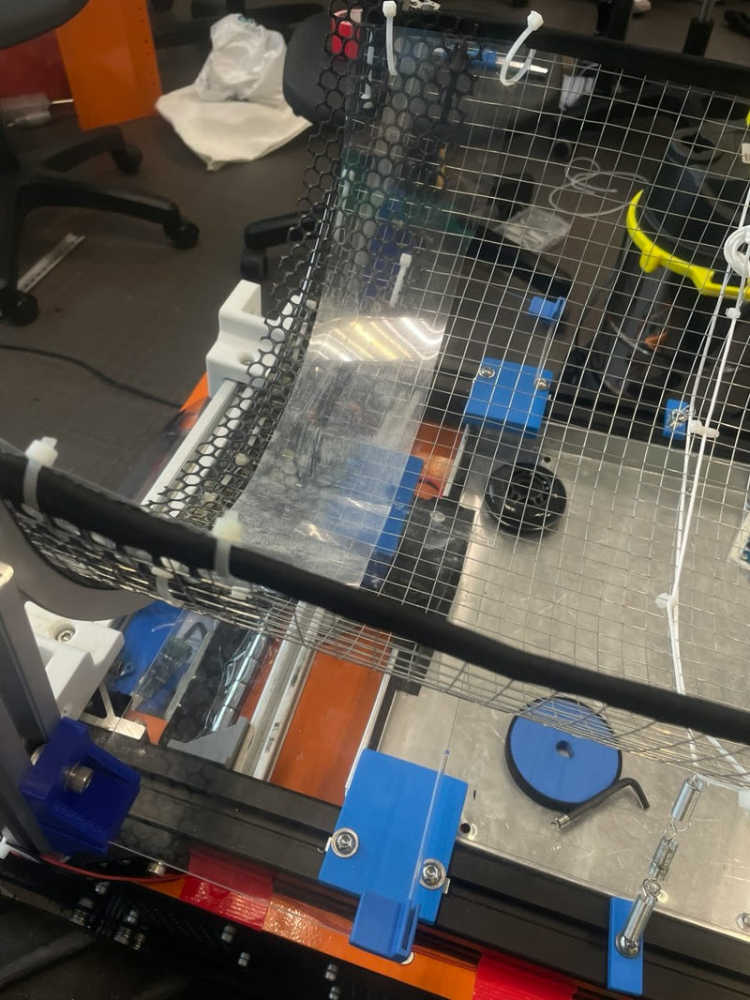 |

*Table 9: Improvements made between ASI-B4.0 and ASI-B5.0.*

Source: Report Section 4.1.3, Table 9.

## 6.5 Noise and emergency stop, ASI-B5.0

The team ran two technical checks before the field and user testing. The checks cover the remaining technical requirements that gate the bench to field test.

| ID | Metric | Test | Result | Threshold | Met |
|---|---|---|---|---|---|
| M8 | Noise level | T1 | Stayed below 60 dB(A) at 1 m while traversing, with the conveyor and the half-drum running. | Below 60 dB(A) at 1 m (D3) | Yes |
| M14 | Emergency stop | S3 | Drive, conveyor and half-drum all stopped immediately. | Mechanism stops immediately (D10) | Yes |

*Table 10: Noise and emergency-stop results at ASI-B5.0.*

Source: Report Section 4.1.4, Table 10.

## 6.6 Field and user testing, ASI-B5.0

The team tested BeachBoy on Palawan Beach, Sentosa, with the controlled debris dataset. The test used dry and wet sand in actual field conditions. The team tested two configurations: with the front paddle attached and not attached.

The team also ran user tests and interviews with two contractor workers and the on-site manager. The build and test log (report reference [18]) holds the test methods, the per-item run grids and the session records.

Source: Report Section 4.2.

### 6.6.1 Collection rate

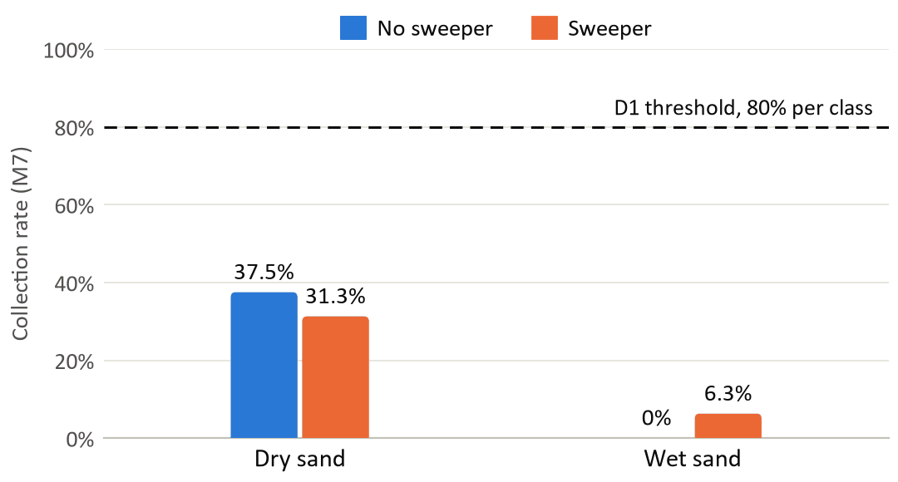

*Figure 18: Overall collection rate (M7) by condition.*

| Sand | No sweeper | Sweeper | D1 threshold |
|---|---|---|---|
| Dry | 37.5% | 31.3% | 80% per class |
| Wet | 0% | 6.3% | 80% per class |

The field collection rate fell short of the threshold, partly due to conveyor jams at intake. Figure 19 divides the chain into its stages to locate the loss.

Source: Report Section 4.2, Figure 18.

### 6.6.2 Intake and transfer by condition

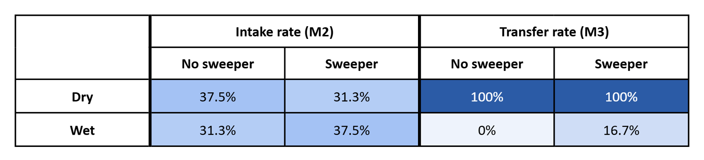

*Figure 19: Intake and transfer by condition, the stages behind the collection rate.*

| Sand | Intake rate (M2), no sweeper | Intake rate (M2), sweeper | Transfer rate (M3), no sweeper | Transfer rate (M3), sweeper |
|---|---|---|---|---|
| Dry | 37.5% | 31.3% | 100% | 100% |
| Wet | 31.3% | 37.5% | 0% | 16.7% |

Intake is already below the 80% threshold in all four conditions. Moisture makes its difference at transfer. Dry transfer holds at 100%. Wet transfer reaches at most 16.7%, against 89.5% in the wet bench test at B4.0.

The report states that the gap comes from the field conditions:

- The wet band lies on a cross-slope, steeper than anticipated.
- Debris on the conveyor therefore slid sideways off the conveyor before it reached the half-drum (Figure 20).
- The acrylic panels on the conveyor were supposed to counteract this slippage, but were not present at the transfer to the half-drum.

D1 is therefore updated. BeachBoy must collect debris in the wet band, on wet sand and at a cross-slope.

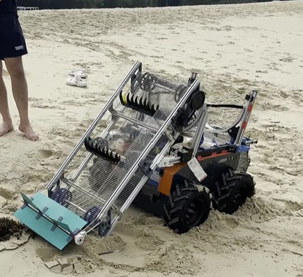

*Figure 20: BeachBoy operating on the wet band, which is at a cross-slope. Debris observed to fail transfer between conveyor and half-drum.*

Source: Report Section 4.2, Figures 19 and 20.

### 6.6.3 Rates per debris class

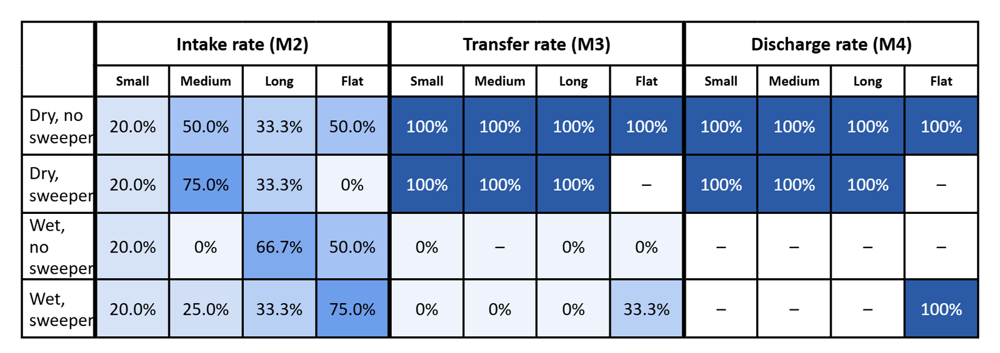

*Figure 21: Intake, transfer and discharge per debris class.*

| Metric | Configuration | Small | Medium | Long | Flat |
|---|---|---|---|---|---|
| Intake rate (M2) | Dry, no sweeper | 20.0% | 50.0% | 33.3% | 50.0% |
| Intake rate (M2) | Dry, sweeper | 20.0% | 75.0% | 33.3% | 0% |
| Intake rate (M2) | Wet, no sweeper | 20.0% | 0% | 66.7% | 50.0% |
| Intake rate (M2) | Wet, sweeper | 20.0% | 25.0% | 33.3% | 75.0% |
| Transfer rate (M3) | Dry, no sweeper | 100% | 100% | 100% | 100% |
| Transfer rate (M3) | Dry, sweeper | 100% | 100% | 100% | – |
| Transfer rate (M3) | Wet, no sweeper | 0% | – | 0% | 0% |
| Transfer rate (M3) | Wet, sweeper | 0% | 0% | 0% | 33.3% |
| Discharge rate (M4) | Dry, no sweeper | 100% | 100% | 100% | 100% |
| Discharge rate (M4) | Dry, sweeper | 100% | 100% | 100% | – |
| Discharge rate (M4) | Wet, no sweeper | – | – | – | – |
| Discharge rate (M4) | Wet, sweeper | – | – | – | 100% |

The table shows a dash where Figure 21 shows a dash.

Per class, intake of medium debris rises with the front paddle fitted. But the front paddle makes the conveyor jam more easily, as debris or the spokes of the front paddle can wedge against the flaps.

Source: Report Section 4.2, Figure 21.

### 6.6.4 Jams and stalls

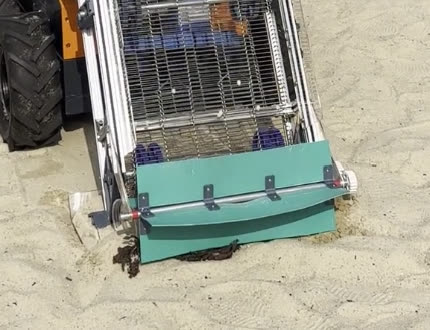

*Figure 22: BeachBoy jammed at the conveyor with the front paddle fitted.*

When the conveyor jammed, it folded back on its pivot and stalled BeachBoy. In both configurations, the beach sand had a lower bearing capacity than the sandpit. The skid therefore sank and accumulated sand ahead of it. This continued until forward motion stopped and the conveyor folded back.

The likelihood increased with the front paddle fitted, as the spokes and the front paddle were more likely to wedge against surrounding sand.

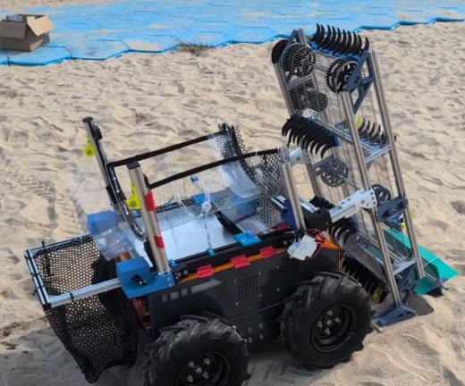

*Figure 23: BeachBoy movement stalled due to pivoting conveyor jamming against the sand.*

Source: Report Section 4.2, Figures 22 and 23.

### 6.6.5 Locomotion

BeachBoy otherwise traversed both sand conditions (M10). On the wet band, its wheels dug in and slipped after a jam and when it climbed the cross-slope.

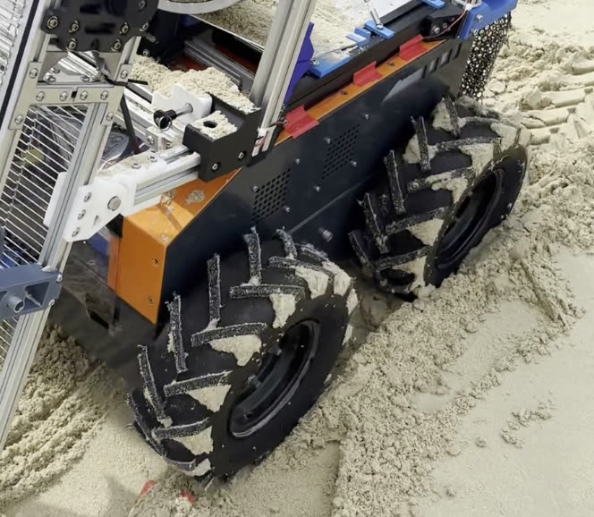

*Figure 24: BeachBoy's wheels digging in and slipping in the wet band.*

Source: Report Section 4.2, Figure 24.

### 6.6.6 Sand separation and clear-out

The majority of sand collected during intake settled on the V plate and tray. The report calls this result an improvement that still misses the sand separation threshold (D2).

Clear-out took 5.23 minutes with two people and hand tools only. This result meets D7.

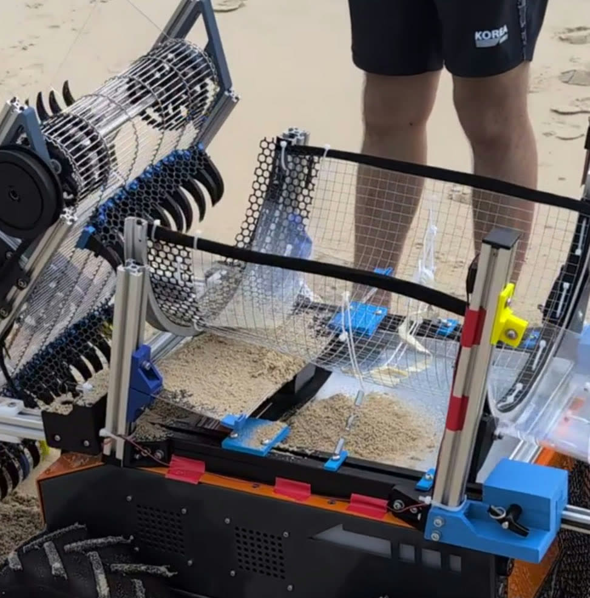

*Figure 25: Majority of sand settling on the V plate and tray.*

Source: Report Section 4.2, Figure 25.

### 6.6.7 Summary metrics

| ID | Metric | Dry, no sweeper | Dry, sweeper | Wet, no sweeper | Wet, sweeper | Met |
|---|---|---|---|---|---|---|
| M1 | Wet to dry intake ratio | — | — | 0.83 | 1.20 | — |
| M13 | Clear-out time | — | — | 5.23 min, two people, hand tools only | — | Yes (D7) |
| M10 | Locomotion in dry and wet sand | Traversed with some impediment from the conveyor | Traversed with some impediment from the conveyor | Traversed with some impediment from the conveyor. Wheels dig in and slip. | Traversed with some impediment from the conveyor. Wheels dig in and slip. | Yes, with limits (D6) |

*Table I.3: Summary metrics for the field session, by condition and configuration.*

Source: Report Appendix I, Table I.3.

## 6.7 User metrics

Two contractor workers attempted 6 operating tasks after a demonstration. The team then interviewed them with the on-site manager. Both workers completed 5 of 6 tasks unaided (M11). All three people found the machine less physically demanding than the current workflow (M12).

| ID | Metric | Operator A | Operator B | On-site manager | Threshold | Met |
|---|---|---|---|---|---|---|
| M11 | Task completion | 5 of 6 unaided. Needed help on task 4, clear a jam and resume. | 5 of 6 unaided. Needed help on task 2, drive it to the working zone. | — | 5 of 6 unaided (D9) | Yes |
| M12 | Physical demand, the machine against the current workflow | Mentioned that the bobcat drops debris that workers have to bend for and collect again. With BeachBoy, the bin is simply lifted out, and this is less tiring. | Mentioned that at present, workers spend hours in the sun collecting a lot of debris. With BeachBoy, it drives and collects instead, which is less demanding. | Mentioned that it will be less tiring. Workers do not need to bend and collect debris as much, manually and after the bobcat collects it. | Reported qualitatively as less demanding (D8) | Yes |

*Table 11: User metrics.*

Operator A and the on-site manager pointed to less bending to re-collect debris dropped by the bobcat. Operator B pointed to driving the machine instead of hours in the sun collecting debris.

Source: Report Section 4.2, Table 11.
