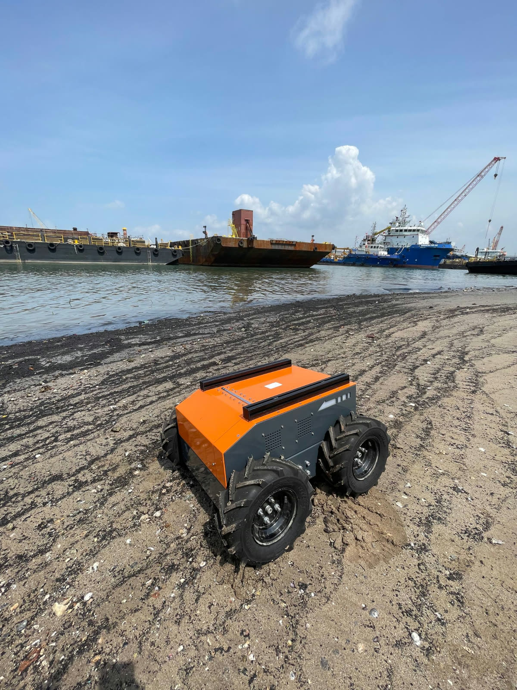

# 8. Carrier Repair and Control Interface

*ASI-301 Engineering Report · Section 8*

[Previous: Section 7](07-calculations.md) · [Contents](../README.md) · [Next: Section 9](09-conclusions.md)

The carrier is the Botsync Copernicus base. This section records the repair of the carrier and the notes for its control interface.

## 8.1 Repair summary

The carrier could not be driven at the start of the project. Its onboard computer would not power up. The control board's STM32 microcontroller normally passes commands to the motor drives, and it did not respond.

Over the summer, the team did this work:

1. The team replaced the onboard computer with a Raspberry Pi.
2. The team modified the control board to bypass the STM32. The board kept only inrush current limiting and the E-stop (emergency stop).
3. The team set up the Raspberry Pi to command the two motor drives directly over RS485.

A wireless controller provides manual control. Subsection 8.3 gives the details.

Source: Report Appendix F.

## 8.2 Proof-of-repair test

The team took the carrier to West Coast Park to confirm that it was fit for its intended use. The team drove it on beach terrain, on both dry and wet sand.

After 30 minutes of continuous operation with no faults, the platform was judged operational and suitable as the base for the project.

*Figure F.1: Copernicus carrier driving on beach terrain with wet sand.*

Source: Report Appendix F, Figure F.1.

## 8.3 Repair details

### 8.3.1 Original architecture (F.1)

The control board of the carrier has an STM32 microcontroller. The STM32 handles all low-level communication with the motor drives and sensors. It also controls peripherals such as the cooling fans and ARGB signal lights.

In normal operation, an onboard computer talks to the STM32 over serial. The computer periodically requests robot state updates and sends motor commands. Both pass into the ROS (Robot Operating System) framework.

### 8.3.2 Fault diagnosis and control board modification (F.2)

The original onboard computer would not power up, so the team used a Raspberry Pi as the replacement host. The team first tried to restore control through the STM32, but the STM32 did not respond to serial requests.

The STM32 was not completely dead. It still detected a connected load and switched the relays that limit inrush current. The team therefore modified the control board to bypass the control functions of the STM32. The board kept only the inrush current limiting and the E-stop.

### 8.3.3 Direct drive communication (F.3)

With the STM32 bypassed, the Raspberry Pi commanded the two Trumman EV servo drives (left and right wheel groups) directly. It used a USB-RS485 adapter and Modbus RTU at 115200 baud.

The team read the drive parameters. The parameters showed that the drives were set to speed mode, not the multi-drive mode that the team first assumed.

In speed mode, the host drives each wheel in two steps. It writes a speed setpoint register, and it toggles a remote run/direction register. The onboard control loops of the drive handle the rest.

The team also found that the DIP switches of the drives were set incorrectly. The first drive on the RS485 bus had its termination resistor enabled, although it was not at the end of the bus. The team then set the DIP switches correctly.

### 8.3.4 Manual control (F.4)

The team connected a wireless controller to a second USB port on the Raspberry Pi. A custom Python script maps the controller inputs to differential-drive commands. The script continuously monitors drive alarms and bus voltage, and it stops both motors on any fault.

With this setup, the carrier was operational again under manual control. The ROS integration was lost.

Source: Report Appendix F (F.1 to F.4).

## 8.4 Control interface notes

These notes record what a third party would need to start the carrier again, or to build autonomy on top of it. They are the practical output of the repair work. They are deliberately specific because two conditions apply. The vendor control path is no longer in use. The vendor documentation alone is now insufficient to reproduce the system.

### 8.4.1 Topology

The command path has these parts, in this order:

1. Host PC or Raspberry Pi.
2. USB-RS485 adapter.
3. One Modbus RTU bus.
4. Two Trumman EV servo drives.

| Drive ID | Wheel |
|---|---|
| 1 | Left |
| 2 | Right |

The Botsync control board and its STM32 are not in the path.

### 8.4.2 Why the team abandoned the vendor path

- The onboard computer was dead.
- The board could not reach the motor controller, so the status LEDs never went green.
- The STM32 firmware is vendor intellectual property, and SWD (Serial Wire Debug) without source exposes register values only.
- The configuration of the RS485 termination resistors made the first drive the end of the bus, so the second drive was unreachable.
- The motor driver parameters were not set.

### 8.4.3 Timing

One Modbus request and response transaction takes on the order of a few hundred milliseconds. Apply these rules to the host software:

1. Time control loops against the wall clock, not against iteration count.
2. Run serial input and output outside the user interface thread.
3. Write commands only on change.

### 8.4.4 Setpoint floor

The drive enforces a hard minimum speed setpoint. It rejects values below this minimum and does not clamp them. Software must treat rejection as an expected response, not as an error.

### 8.4.5 Current limits

Each drive motor is rated at 8 A continuous. Transient draw is higher on rough terrain and during zero-radius turns. Command a finite turning radius, not spot turns.

### 8.4.6 Adapter latency

The latency timer of the USB serial adapter is about 16 ms by default. Reducing the timer to 1 ms is expected to be the largest single improvement to loop rate. The adapter latency effect has not been measured.

Source: Report Appendix G.

[Previous: Section 7](07-calculations.md) · [Contents](../README.md) · [Next: Section 9](09-conclusions.md)
